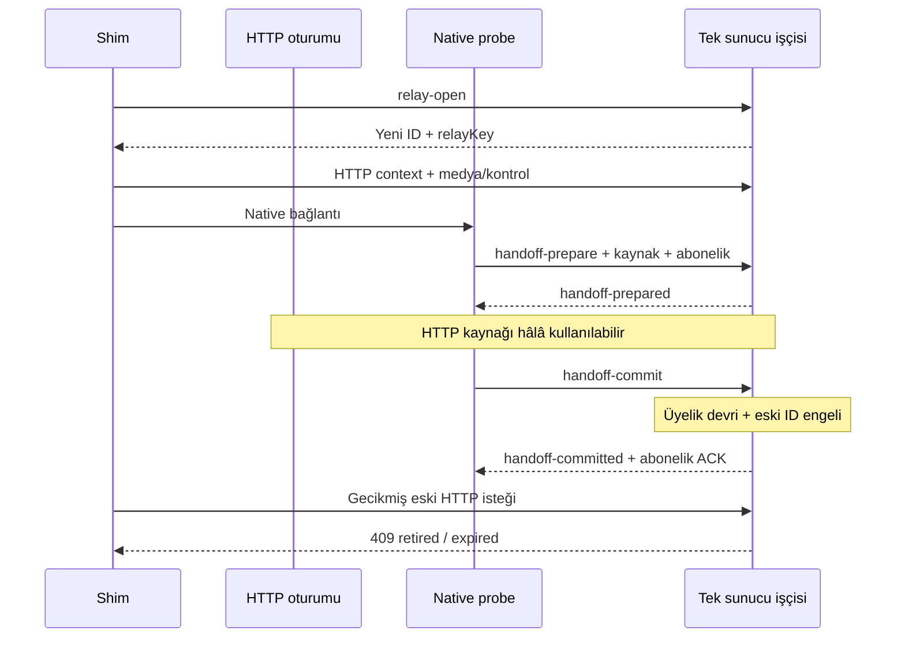

# RıdvanSes v55 uygulama doğrulaması ve v56 atomik handoff yaması

**Tarih:** 8 Kasım 2026  
**İncelenen gerçek HEAD:** `7f45ce8240fcd1310c6851d472b0a61096424079`  
**Teslim:** Yalnız `AUDIO_EXCELLENCE_REPORT.md`. Gerçek kaynaklar değiştirilmedi.

**Karar:** v55 unified diff’i eksiksiz uygulanmış; doğrudan disk testi **28/28 PASS + V53 PASS + V54 PASS + V55 PASS, exit0**. P1-01 boş-poll ve P2-02 kısmi metadata düzeltmeleri yeniden doğrulandı. **P1-03 diskteki v55’te açık**: geç gelen eski HTTP isteği native soketi hâlâ terminate edebiliyor. Bu rapor yeni oturum protokolü, prepare/commit devri, eski oturum engellemesi ve hata kurtarmasını birlikte içeren uygulanabilir **v56** diff’i verir. Aday sürüm kaynaklara yazılmadan **30/30 PASS, exit0** ile sınandı.

## 1. Diskten v55 ve diff eşliği

Çalıştırılan komut:

```powershell
node scripts/verify-system.js
```

Gözlenen ilgili çıktı:

```text
[BAŞARILI / PASS] ADIM-3.V55 — Kısmi kimlik korunumu; MQTT bağlıyken native PCM ve family/admin HTTP güncellemeleri
V55 PASS: partial name/phone/lang/device preservation; broker-connected empty HTTP poll; mixed native PCM; family/admin deltas
V53 PASS: source-only DSP/SRC/comfort/profile, queue/PLC/seq, binary+JSON dedup, coalescer, congestion, HTTP single-flight/drain/close, gesture/wake/pause
V54 PASS: 3 sample rates; DSP/profile bounds; PLC restart/wrap; single join/ACK for 3 modes; pending/coalescer order; POST context; all shim URLs
TÜM DOĞRULAMA TESTLERİ TAMAMLANDI: 28 / 28 [BAŞARILI / PASS]
```

Süreç çıkışı **0**. 18 JS dosyası ve 9 HTML’de 10 inline script sözdizimi kontrolü geçti. Önceki rapordaki v55 diff’i `git apply --reverse --check --ignore-space-change -` ile, dosyalara uygulamadan sınandı: **exit0**. Önceki 12 kaynak dosyası değişikliği mevcut ağaçla eşleşiyor.

| v55 gereksinimi | Gerçek kaynak | Sonuç |
|---|---|---|
| MQTT bağlıyken boş HTTP poll | public/vercel-ws-shim.js:842–875; eski847 return’ü kaldırılmış | PASS; gerçek native rehber PCM’i HTTP hacıya ulaşıyor |
| Kısmi alan korunumu | server.js:1353–1383 | PASS; aynı oda/rolde verilmemiş name/deviceId/phone/lang tamamlanıyor; PIN/token devralınmıyor |
| v55 E2E | scripts/verify-system.js:577,1532 ve devamı | PASS; kimlik, native dedup, PCM ve family/admin delta |
|6 boş-poll kombinasyonu | scripts/verify-system.js:1513–1525 | PASS;3 abonelik tipi ×2 broker bağlantı durumu |
| Cache/HTML | public/sw.js:4,11;8 shim giriş sayfası; dinle SW register |55; değişmeyen DSP worklet URL’leri53-audio, doğru |
| Capture/player | public/pcm-capture-worklet.js / pcm-player-worklet.js | v55 commit’inde değişmemiş; mevcut DSP/SRC/PLC/wrap testleri PASS |

İnceleme başında silinmiş görünen `AUDIT_FIX_SUMMARY.md` ve `AUDIT_REPORT.md` kullanıcı değişikliklerine dokunulmadı. Yerel test paketi runtime.json snapshot’ını geri yükledi.

## 2. Diskteki v55 üzerinde ek tekrar üretimi

Yalnız verify kodunu bellekte genişleten tanı koşusu, **gerçek v55 server ve shim dosyalarını** kullandı. Kaynaklar ve mevcut28 sonuç değiştirilmedi.

```text
AUDIT V55 PARTIAL METADATA:
{"phone":"audit-phone","lang":"ar","name":"Updated name"}

AUDIT V55 CONNECTED MQTT EMPTY POLL:
{"fetches":1,"deliveredAudio":1,"serverStillHadAudio":[]}

AUDIT V55 STALE RELAY AFTER NATIVE JOIN:
{"nativeTerminated":true}
```

İlk iki çıktı v55’in önceki kusurları giderdiğinin doğrudan teyididir. Son çıktı şu sunucu işleme sırasını üretir:

1. HTTP rehber tur/oda/deviceId ile katılır.
2. Aynı kimlikli native soket katılır ve joined alır; eski HTTP üyeliği silinir.
3. Eski HTTP oturumunun bir isteği daha işlenir.
4. `syncRysRelayJoin` üyeyi bulamadığı için yeniden join yapar; `server.js:948–965` sameDevice/sameGuide döngüsü native soketi terminate eder.

Kritik yerler: `server.js:1370–1383` yeniden katılım, `1433` HTTP oturumu edinimi; `public/vercel-ws-shim.js:293–349` probe join’i. İstemci onopen tekrarını yutmak veya AbortController kullanmak, sunucuda bu sırayı atomik hâle getirmez. Bu koşu fiziksel roaming/abort zamanlamasını ölçmez; gecikmiş isteğin native join’den sonra işlenmesi sırasını gerçek yerel endpoint’lerle doğrular.

## 3. v56 protokolü: neden yalnız bir ek if yeterli değil?

Eski oturuma kısa süreli “retired” bayrağı koyup35 sn sonra kaydı silmek yeterli değildir. Aynı clientId ile getOrCreate yapılırsa geç bir istek eski oturumu tekrar yaratabilir. Ayrıca probe doğrudan join yaptığı sürece hazırlık aşaması bile eski üyeyi düşürebilir.

v56 bu iki sorunu ayırır:

- **relay-open:** Sunucu rastgele `rys56-…` kimliği ve192 bit `relayKey` verir. Açılış **join, ses veya kontrol mesajı çalıştırmaz**. Geç bir açılış isteği yalnız boş, kullanılmayan bir oturum yaratabilir.
- **Normal HTTP:** Sunucunun verdiği ID+anahtar gerekir. Bilinmeyen veya temizlenmiş bir `rys56-…` ID **409** alır; getOrCreate ile yeniden yaratılmaz. Yanlış anahtar401. GET’te anahtar yalnız başlıktan alınır; yeni shim yalnız POST kullanır.
- **handoff-prepare:** Yeni native soket hedef aboneliği ve varsa HTTP kaynak anahtarını sunar. Sunucu yetki/PIN, kaynak bağlam özeti ve revision kontrol eder;128 bit işlem bileti verir. **Odaya katılmaz ve HTTP kaynağını silmez.**
- **handoff-commit:** Bilet,3 sn ömrü, güncel yetki/PIN, kaynak üyeliği ve revision tekrar kontrol edilir. Üyelik devri ve eski HTTP kaynağının emekliye ayrılması, aynı senkron Node handler’ında yapılır. ACK ancak bundan sonra `handoff-committed` zarfında çıkar.
- **Commit sonrası:** Eski anahtarlı HTTP istekleri409; temizleme sonrası da bilinmeyen ID409. Aynı commit’in tekrarı cached ACK döndürür, ikinci join/broadcast oluşturmaz.
- **İptal/hata:** Commit öncesi cancel, close veya timeout HTTP üyeliğini etkilemez. Commit gönderildikten sonra ACK kaybolursa istemci eski ID’yi yeniden kullanmaz; probe’u kapatıp yeni HTTP ID alır. Bu, commit’i geri almak yerine yeni bir oturumla kontrollü toparlanmadır.
- **relay-close:** Yalnız eski HTTP ID+anahtarını kapatan, tekrar çağrılabilir best-effort temizlik. Native clientId farklı olduğundan geç gelen close yeni native üyeyi silemez. Sunucu35 sn temizleme mekanizması da korunur.



**Atomiklik sınırı:** Bir handler’da await olmaması nedeniyle commit ortasına başka HTTP handler’ı girmez. Commit’ten önce işlenen istek eski geçerli kaynaktır; sonrakiler kaynak engeline takılır. Sonradan bilinçli yapılan, yeni kimlikli yetkili bir bağlantı yine normal yayıncı devir kurallarına tabidir. Bu yama bütün yetkili bağlantıların birbirini hiç değiştirememesi gibi bir kural koymaz.

## 4. Uygulama ayrıntıları ve kurtarma davranışı

### Sunucu

- prepare ve commit ayrı mesaj tipleri; normal joined/family/admin ACK üretimi küçük `sendRysSubscriptionAck` yardımcısına alınır. İşlem sırasında ACK capture edilir; kaynak engeli kurulduktan sonra iletilir.
- Kısmi HTTP metadata’sı native’e geçerken tamamlanır. DeviceId boş hacıda bile kaynak üyelik açıkça kaldırılır; heuristik dedup’a bırakılmaz. Son joined snapshot’ı kaynak kaldırıldıktan sonra yeniden hesaplanır.
- Başka yeni HTTP nesli eski bir v56 üyeyi aynı cihaz/rehber kimliğiyle değiştirirse eski anahtarlı nesil de emekliye ayrılır. Böylece iptal/toparlanma sonrası iki eski neslin birbirini tekrar ele geçirmesi önlenir.
- Anahtarlar sabit uzunluklu hex olarak doğrulanıp timingSafeEqual ile karşılaştırılır. Unicode48 karakterin48 bayt olmaması nedeniyle karşılaştırmanın istisna atması önlenir.
- Token/PIN commit’te tekrar doğrulanır; prepare sırasında geçerli olup daha sonra iptal edilen yetki üyeliği taşıyamaz.
- Bağlam değişirse revision/digest uyuşmaz; commit reddedilir. HTTP bağlam revision’u için ham PIN/token yerine SHA-256 özeti tutulur; commit doğrulamasına gereken istek alanları kısa ömürlü native hazırlık kaydında kalır. Native commit için gerekli sırlar yalnız WSS isteğinde bulunur.
- Server prepare zaman aşımı3 sn, istemci toplam probe watchdog’u5 sn. Cancel ve ws.close timer’ı temizler. Commit tekrarı frozen JSON ACK ile idempotenttir.

### İstemci

- MQTT’deki `_clientId` değişmez. HTTP’nin özel `_relayClientId / _relayKey` alanları ayrı tutulur; relay anahtarı public MQTT’ye veya sessionStorage’a yazılmaz.
- HTTP açılışı MQTT’yi bekletmez. API kapalıyken MQTT ses akışı sürdürülebilir; test bu bağımsızlığı doğrular. Yeni HTTP session gerektiğinde fazladan açılış RTT’si vardır.
- HTTP, native commit ACK’sı beklenirken409 retired alırsa poll geçici durur; aynı anda yeni HTTP oturumu açıp native’i geri itmez.
- Başarısız/ACK’sı kayıp commit sonrası eski ID temizlenir, yeni ID ile katılım yapılır. Son guide-stream-state yeniden gönderilir; sürekli yayın bayrağı ve konu yeni HTTP nesline taşınır.
- Epoch/context guards geç gelen relay-open cevabının kapalı veya native’e geçmiş soketi yeniden canlandırmasını önler.
- Başarılı native commit’ten sonra ACK→onopen sırası korunur; aynı abonelik yeniden gönderilmez. Taze pending ses, sonra kısmi coalescer flush edilir. Eski medya TTL’leri korunur ve HTTP açılışından sonra medya yaşı yeniden süzülür.
- Abonelik tipi/oda değişiminde eski ses ve stream-state temizlenir. Family/admin’a geçerken rehberin eski ses paketleri yeni kapsama taşınmaz.

İlk açılış/başarısız devir sırasında bazı örneklerin TTL nedeniyle düşmesi veya yeniden tamponlama mümkündür. P1-03’ün giderilmesi “sıfır sözcük kaybı”, anlık OS kurtarması veya akustik yankı izolasyonu kanıtı değildir.

## 5. Test kapsamı ve tamamlanan sonuçlar

| Kontrol | Çalıştırma türü | Sonuç |
|---|---|---|
| v55 baseline | Gerçek disk, node scripts/verify-system.js |28/28 PASS, V53/V54/V55 PASS, exit0 |
| v55 diff eşliği | Önceki diff reverse-check | exit0 |
| v55 ek tanı | Gerçek yerel server/shim, verify bellekte genişletildi | İki v55 düzeltmesi doğrulandı; eski native-termination yeniden üretildi |
| v56 diff uygulanabilirliği | git apply --check --ignore-space-change -; uygulama yok | exit0 |
| Aday sözdizimi | Değişen JS stdin’den node --check; HTML inline VM |14 derleme PASS |
| v56 E2E grubu | Gerçek Express/WS localhost3999 | PASS |
| v56 hata/yarış grubu | Gerçek kaynak fonksiyonları; saat/ağ/ACK kontrollü fixture | PASS |
| Son tam aday paket | Aday server/shim/verify bellekte; gerçek yerel HTTP/WS | **30/30 PASS, V53/V54/V55 ve V56 E2E/UNIT PASS, exit0** |

Yeni E2E kontrolü; yan etkisiz open/prepare, prepare sırasında HTTP PCM devamı, cancel, HTTP bağlam değişimi, commit, geç eski isteğin409 alması, native PCM’in devamı, commit tekrarı, private outbox anahtarı, bozuk/Unicode anahtar, boş deviceId hacı, PIN, aile/admin ve MQTT-only başlangıcı kapsar. Yeni HTTP neslinin eski v56 neslini emekliye ayırması da sınanır.

Yeni kaynak testi;3 sn prepare süresinin dolmasını saat fixture’ıyla, prepare→commit arasında token iptalini, cancel’ı, silinmiş ID’nin yeniden yaratılmamasını, kayıp commit ACK’sında HTTP409 beklemesini,5 sn client watchdog sonrası yeni ID alımını, geç open cevabını ve API kapalıyken MQTT gönderimini sınar. Bunlar fiziksel ağda paket kaybı ölçümü değildir.

Mevcut v53/v54/v55 DSP, seq, PLC, HTTP matris ve kimlik assertion’ları korunur. Eski sahte probe fixture’ları doğrudan joined üretmek yerine gerçek v56 prepared/committed zarflarını üretir; aynı aboneliğin tekrar normal join olarak yollanmadığı ayrıca doğrulanır. Eski HTTP fixture’ları kurulu oturumu temsil edecek şekilde düzenlenir.

Önizleme aracı yalnız rapordaki diff’i bellekte uygular. Testlerin kaynak okumaları aday metinlere yönlendirilir, testlerin raporu okuması engellenir. Ana paketin child-process syntax kontrolleri diski gördüğünden aday syntax ayrı stdin/VM ile sınanmıştır. **30/30, v56 diske uygulanmış veya production’da çalışmış bir sonuç değildir.**

## 6. Dağıtım ve garanti sınırları

1. **Önce sunucu:** v56 relay-open/close ve native prepare/commit handler’ları hazır olmalı. Yeni shim eski sunucuyla HTTP oturumu açamaz; MQTT bağımsızlığı bunun yerine HTTP eşliği garantisi vermez.
2. **Sonra shim/cache:**8 giriş sayfası shim56, SW cache56, dinle SW register56. Değişmeyen capture/player URL’leri53-audio kalır.
3. **Eski sekmeler:** Açık v55 sekmesi yeni JS’i kendiliğinden kullanmaz. Tam atomik devir değerlendirmesi v56 istemci+sunucu ve yeni `rys56-…` HTTP oturumları içindir. Legacy HTTP/ordinary-join yolu uyumluluk için korunur; protokole girmeyen eski istemcilerin handoff’u atomik hâle gelmiş sayılmaz. Eski legacy ID’nin temizleme sonrası yeniden oluşturulmasını önleyen garanti bu eski biçim için verilmez. Aktif istemcilerin geçişi ayrıca planlanmalıdır.
4. **Tek işçi / ortak durum:** HTTP oturumu ve native WS aynı Node işçisinde olmalıdır. Uygulama RAM Map’leri kullanıyor. Cluster/çok instance için ortak transactional/CAS store ve yönlendirme gerekir; yalnız bu diff farklı işçileri tek sahiplik alanına dönüştürmez. Node belgeleri cluster worker’larının ayrı süreçler olduğunu ve oturum RAM’ine aşırı bağımlılığın tasarım sınırı olduğunu belirtir. [Node.js Cluster](https://nodejs.org/api/cluster.html)
5. **Üretim kapsamı:** GitHub/VDS/Vercel dağıtımı kullanıcı beyanıdır; bu çalışmada SSH, deploy, push veya production oturum mutasyonu yapılmadı. Yerel protokol testleri; gerçek roaming, iOS/Android arama/kilit veya binlerce kullanıcı yük testi yerine geçmez.
6. **Mevcut diğer sınırlar:** Public MQTT kimlik/ACL mimarisi, çok cihazlı AEC, Opus/SFU ölçek planı ve OS arka plan sürekliliği bu yamanın kapsamı değildir. HTTP poll yükü mevcut100 ms düzeyindedir; ilk session açılışı ve best-effort close ek istek getirir. Kontrol mesajları için uçtan uca exactly-once işlem garantisi verilmez.

v55’in P1-01/P2-02 uygulaması onaylanır. Diskteki P1-03 için v56 gereklidir; önerilen çözüm, yukarıdaki yeni protokol ve tek işçi kapsamındaki tanımlı yarışta yerel doğrulamadan geçmiştir. Genel “tüm akustik/şebeke/OS koşullarında kusursuzluk” onayı verilmez.

## 7. Tam uygulanabilir v56 unified diff

**Hedef HEAD:**7f45ce8. Bu denetim yamayı kaynaklara uygulamaz. Aşağıdaki diff eksiksiz yeni helper/metot/test kodlarını ve cache sürümlerini içerir. İleride UTF-8 patch olarak çıkarılıp önce `git apply --check`, sonra `git apply` ve `node scripts/verify-system.js` ile gerçek diskten tekrar doğrulanabilir. Rapor hazırlanırken bu check zaten exit0 verdi; beklenen yeni toplam30 sonuç grubudur.


```diff
diff --git a/server.js b/server.js
--- a/server.js
+++ b/server.js
@@ -73,7 +73,7 @@
   ) {
     res.setHeader('Access-Control-Allow-Origin', origin);
     res.setHeader('Access-Control-Allow-Methods', 'GET,POST,PUT,PATCH,DELETE,OPTIONS');
-    res.setHeader('Access-Control-Allow-Headers', 'Content-Type, Authorization, X-RY-Auth');
+    res.setHeader('Access-Control-Allow-Headers', 'Content-Type, Authorization, X-RY-Auth, X-Rys-Relay-Key');
     res.setHeader('Access-Control-Allow-Credentials', 'true');
   }
   if (req.method === 'OPTIONS') {
@@ -882,14 +882,12 @@
       return;
     }
     ws.isAdmin = true;
-    ws.send(
-      JSON.stringify({
+    sendRysSubscriptionAck(ctx, {
         type: 'admin-rooms-update',
         rooms: Array.from(liveRooms.values()).map((r) => serializeRoom(r, true)),
         sosAlerts: db.sosAlerts,
         announcements: db.announcements
-      })
-    );
+      });
     return;
   }
 
@@ -898,16 +896,14 @@
     ws.familyTourCode = tourCode;
     const room = getOrCreateRoom(tourCode, 'genel');
     const steps = getTourSteps(tourCode);
-    ws.send(
-      JSON.stringify({
+    sendRysSubscriptionAck(ctx, {
         type: 'family-state',
         tourCode,
         room: serializeRoom(room, false),
         steps,
         stats: computeJourneyStats(steps),
         announcements: db.announcements.filter((a) => a.tourCode === tourCode || a.tourCode === 'ALL')
-      })
-    );
+      });
     return;
   }
 
@@ -952,6 +948,10 @@
         const sameDevice = Boolean(deviceId && existingClient.deviceId && existingClient.deviceId === deviceId);
         const sameGuide = Boolean(role === 'guide' && existingClient.role === 'guide' && r.roomId === roomId && existingClient.name === clientObj.name);
         if (sameDevice || sameGuide) {
+          if(existingClient.ws?.isHttpRelay){
+            const oldRelay=httpRelaySessions.get(existingId);
+            if(oldRelay&&(oldRelay.relayKey||ctx.rysAckCapture))oldRelay.relayRetired=true;
+          }
           r.clients.delete(existingId);
           if (r.activePublisherClientId === existingId) {
             r.activePublisherClientId = clientId;
@@ -979,8 +979,7 @@
     }
 
     const tourSteps = getTourSteps(tourCode);
-    ws.send(
-      JSON.stringify({
+    sendRysSubscriptionAck(ctx, {
         type: 'joined',
         clientId,
         room: serializeRoom(ctx.currentRoom, role === 'guide'),
@@ -988,8 +987,7 @@
         siyerPoints: db.siyerPoints,
         steps: tourSteps,
         stats: computeJourneyStats(tourSteps)
-      })
-    );
+      });
     broadcastRoomState(ctx.currentRoom);
     return;
   }
@@ -1201,7 +1199,8 @@
     clientId: `client-${Date.now()}-${clientSeq++}`,
     ws,
     currentRoom: null,
-    isAuthenticated: ws.isAuthenticated
+    isAuthenticated: ws.isAuthenticated,
+    rysHandshakeToken: extractAuthTokenFromReq(req)
   };
 
   ws.on('message', (raw, isBinary) => {
@@ -1262,10 +1261,12 @@
     } catch {
       return;
     }
+    if(handleRysNativeHandoff(ctx,msg))return;
     processClientJsonMessage(ctx, msg);
   });
 
   ws.on('close', () => {
+    clearRysHandoff(ctx);
     if (ctx.currentRoom) {
       removeClientFromRoom(ctx.currentRoom, ctx.clientId);
     }
@@ -1342,6 +1343,145 @@
     .map((e) => e.message);
 }
 
+// v56: opaque HTTP sessions; opening never joins a room or executes messages.
+function openRysRelay56(res){
+  const s=getOrCreateRelaySession('rys56-'+crypto.randomBytes(18).toString('hex'));
+  s.relayKey=crypto.randomBytes(24).toString('hex');
+  s.relayRevision=0;s.relayDigest=null;s.relayRetired=false;
+  return res.json({type:'relay-opened',clientId:s.clientId,relayKey:s.relayKey});
+}
+function closeRysRelay56(req,res){
+  const s=httpRelaySessions.get(String(req.body?.clientId||''));
+  const a=String(req.body?.relayKey||''),b=String(s?.relayKey||'');
+  if(!s||!/^[0-9a-f]{48}$/.test(a)||!/^[0-9a-f]{48}$/.test(b)||
+    !crypto.timingSafeEqual(Buffer.from(a),Buffer.from(b)))
+    return res.status(401).json({error:'relay-key-required'});
+  s.relayRetired=true;s.ws.isAdmin=false;s.ws.familyTourCode=null;
+  if(s.currentRoom?.clients.has(s.clientId))removeClientFromRoom(s.currentRoom,s.clientId,0);
+  return res.json({closed:true});
+}
+function resolveRysRelay(req,res,input){
+  const id=String(input?.clientId||'');
+  let s=httpRelaySessions.get(id);
+  if(id.startsWith('rys56-')){
+    if(!s){res.status(409).json({error:'relay-session-expired'});return null;}
+    const supplied=String((req.method==='GET'?null:input?.relayKey)||req.headers?.['x-rys-relay-key']||'');
+    const expected=String(s.relayKey||'');
+    if(!/^[0-9a-f]{48}$/.test(supplied)||!/^[0-9a-f]{48}$/.test(expected)||
+      !crypto.timingSafeEqual(Buffer.from(supplied),Buffer.from(expected))){
+      res.status(401).json({error:'relay-key-required'});return null;
+    }
+  }else s=s||getOrCreateRelaySession(id);
+  if(s.relayRetired){res.status(409).json({error:'relay-session-retired'});return null;}
+  s.lastSeen=Date.now();return s;
+}
+function digestRysSubscription(m){
+  if(!m)return null;
+  return crypto.createHash('sha256').update(JSON.stringify([
+    m.type,String(m.tourCode||'RY-KASIM').toUpperCase().trim(),
+    String(m.roomId||'genel').trim(),m.role==='guide'?'guide':'pilgrim',
+    m.name||'',m.deviceId===undefined?null:String(m.deviceId).trim(),
+    m.phone===undefined?null:m.phone,m.lang===undefined?null:m.lang,
+    m.pin===undefined?null:String(m.pin),m.token||''
+  ])).digest('hex');
+}
+function sendRysSubscriptionAck(ctx,payload){
+  if(ctx.rysAckCapture)ctx.rysAckCapture.ack=payload;
+  else ctx.ws.send(JSON.stringify(payload));
+}
+function clearRysHandoff(ctx){
+  if(ctx.rysHandoff?.timer)clearTimeout(ctx.rysHandoff.timer);
+  ctx.rysHandoff=null;
+}
+function validateRysHandoff(ctx,request){
+  const authed=!!(isValidAuthToken(request.token)||isValidAuthToken(ctx.rysHandshakeToken));
+  ctx.isAuthenticated=authed;ctx.ws.isAuthenticated=authed;
+  if((request.type==='admin-subscribe'||request.type==='join'&&request.role==='guide')&&!authed)
+    return 'auth-required';
+  if(request.type==='join'&&request.role!=='guide'&&!authed){
+    const code=String(request.tourCode||'RY-KASIM').toUpperCase().trim();
+    const tour=(db.tours||[]).find(t=>String(t.code||'').toUpperCase()===code);
+    if(tour?.pinProtected&&tour.pin&&String(tour.pin).trim()!==String(request.pin||'').trim())
+      return 'pin-required';
+  }
+  return null;
+}
+function handleRysNativeHandoff(ctx,msg){
+  if(!['handoff-prepare','handoff-commit','handoff-cancel'].includes(msg?.type))return false;
+  const reply=payload=>ctx.ws.send(JSON.stringify(payload));
+  const fail=code=>{clearRysHandoff(ctx);reply({type:'handoff-error',code});};
+  if(msg.type==='handoff-cancel'){clearRysHandoff(ctx);return true;}
+  if(msg.type==='handoff-prepare'){
+    if(ctx.currentRoom||ctx.ws.isAdmin||ctx.ws.familyTourCode){fail('probe-already-subscribed');return true;}
+    const raw=msg.subscription;
+    if(!raw||!['join','family-subscribe','admin-subscribe'].includes(raw.type)||
+      JSON.stringify(raw).length>8192){fail('invalid-subscription');return true;}
+    const request=JSON.parse(JSON.stringify(raw));
+    const invalid=validateRysHandoff(ctx,request);if(invalid){fail(invalid);return true;}
+    let source=null;
+    if(msg.relayClientId){
+      source=httpRelaySessions.get(String(msg.relayClientId));
+      const a=String(msg.relayKey||''),b=String(source?.relayKey||'');
+      if(!source||source.relayRetired||!/^[0-9a-f]{48}$/.test(a)||!/^[0-9a-f]{48}$/.test(b)||
+        !crypto.timingSafeEqual(Buffer.from(a),Buffer.from(b))){
+        fail('stale-relay');return true;
+      }
+      if(!source.relayDigest||source.relayDigest!==digestRysSubscription(request)){
+        fail('context-changed');return true;
+      }
+      // Transfer optional identity fields from this same existing HTTP membership.
+      if(request.type==='join'){
+        const previous=source.currentRoom?.clients.get(source.clientId);
+        if(!previous){fail('source-not-joined');return true;}
+        request.name=request.name||previous.name;
+        for(const key of ['deviceId','phone','lang'])
+          if(request[key]===undefined)request[key]=previous[key];
+      }
+    }
+    clearRysHandoff(ctx);
+    const pending={id:crypto.randomBytes(16).toString('hex'),request,source,
+      revision:source?.relayRevision||0,digest:source?.relayDigest||null,expires:Date.now()+3000};
+    pending.timer=setTimeout(()=>{
+      if(ctx.rysHandoff===pending){ctx.rysHandoff=null;reply({type:'handoff-error',code:'prepare-expired'});}
+    },3000);pending.timer.unref?.();
+    ctx.rysHandoff=pending;
+    reply({type:'handoff-prepared',handoffId:pending.id});return true;
+  }
+  if(ctx.rysCommittedHandoff?.id===msg.handoffId){
+    ctx.ws.send(ctx.rysCommittedHandoff.envelope);return true; // Idempotent retry; no second join.
+  }
+  const p=ctx.rysHandoff;
+  if(!p||p.id!==msg.handoffId||Date.now()>p.expires){fail('prepare-expired');return true;}
+  if(p.source&&(httpRelaySessions.get(p.source.clientId)!==p.source||p.source.relayRetired||
+    p.source.relayRevision!==p.revision||p.source.relayDigest!==p.digest||
+    p.request.type==='join'&&!p.source.currentRoom?.clients.has(p.source.clientId))){
+    fail('context-changed');return true;
+  }
+  const invalid=validateRysHandoff(ctx,p.request);if(invalid){fail(invalid);return true;}
+  const capture={ack:null};ctx.rysAckCapture=capture;
+  try{
+    // No await in this transaction: membership transfer and source fencing are one event-loop turn.
+    processClientJsonMessage(ctx,p.request);
+    const expected=p.request.type==='join'?'joined':
+      p.request.type==='family-subscribe'?'family-state':'admin-rooms-update';
+    if(capture.ack?.type!==expected){fail('subscription-rejected');return true;}
+    if(p.source){
+      p.source.relayRetired=true;p.source.ws.isAdmin=false;p.source.ws.familyTourCode=null;
+      if(p.source.currentRoom?.clients.has(p.source.clientId))
+        removeClientFromRoom(p.source.currentRoom,p.source.clientId,0);
+    }
+    if(p.request.type==='join')capture.ack.room=serializeRoom(ctx.currentRoom,p.request.role==='guide');
+    const envelope=JSON.stringify({type:'handoff-committed',handoffId:p.id,ack:capture.ack});
+    ctx.rysCommittedHandoff={id:p.id,envelope};
+    clearRysHandoff(ctx);ctx.ws.send(envelope);
+  }catch(e){
+    clearRysHandoff(ctx);
+    try{reply({type:'handoff-error',code:'commit-failed'});}catch(ignore){}
+    try{ctx.ws.close();}catch(ignore){}
+  }finally{ctx.rysAckCapture=null;}
+  return true;
+}
+
 // PATCH: relay-auth-v53
 function applyRysRelayAuth(session,req,token,context){
   const authenticated=!!(isRequestAuthenticated(req)||isValidAuthToken(token)||isValidAuthToken(context?.token));
@@ -1417,6 +1557,12 @@
     return res.json({clientId:session.clientId,messages:errors.length?errors:
       [{type:'pin-error',message:'Kafile/oda katılımı reddedildi; PIN ve yetkiyi kontrol edin.'}]});
   }
+  if(session.relayKey&&context){
+    const digest=digestRysSubscription(context);
+    if(session.relayDigest!==digest){session.relayDigest=digest;session.relayRevision=(session.relayRevision||0)+1;}
+  }
+  if(session.relayKey&&!context&&messages.some(m=>['join','family-subscribe','admin-subscribe'].includes(m?.type)))
+    return res.status(400).json({error:'relay-context-required'});
   for(const m of messages){
     if(!m||typeof m!=='object')continue;
     // Explicit context is the latest subscription. Do not replay stale queued joins.
@@ -1427,10 +1573,13 @@
 }
 
 app.post('/api/ws-relay',(req,res)=>{
+  if(req.body?.type==='relay-open'&&req.body.version===56)return openRysRelay56(res);
+  if(req.body?.type==='relay-close'&&req.body.version===56)return closeRysRelay56(req,res);
   const {clientId,messages,joinContext,subscriptionContext,token}=req.body||{};
   const context=subscriptionContext||joinContext||null;
   const list=Array.isArray(messages)?messages:req.body?.message?[req.body.message]:[];
-  return serveRysRelay(getOrCreateRelaySession(clientId),req,res,token,context,list);
+  const session=resolveRysRelay(req,res,req.body||{});if(!session)return;
+  return serveRysRelay(session,req,res,token,context,list);
 });
 app.get('/api/ws-relay',(req,res)=>{
   // Legacy GET is retained. Existing joined sessions need not repeat their PIN.
@@ -1442,7 +1591,8 @@
       name:q.name||'',pin:q.pin||'',token:q.token,
       ...(q.deviceId!==undefined?{deviceId:q.deviceId}:{}),
       ...(q.phone!==undefined?{phone:q.phone}:{}),...(q.lang!==undefined?{lang:q.lang}:{})}:null;
-  return serveRysRelay(getOrCreateRelaySession(q.clientId),req,res,q.token,context);
+  const session=resolveRysRelay(req,res,q);if(!session)return;
+  return serveRysRelay(session,req,res,q.token,context);
 });
 
 // ======================== REST API ENDPOINTS ========================
diff --git a/scripts/verify-system.js b/scripts/verify-system.js
--- a/scripts/verify-system.js
+++ b/scripts/verify-system.js
@@ -575,6 +575,7 @@
   await runV53RelayRoundTrip({baseUrl,token:authToken});
   await runV54RelayRoundTrip({baseUrl,url:wsUrl,token:authToken});
   await runV55RelayEdgeChecks({baseUrl,url:wsUrl,token:authToken});
+  await runV56HandoffChecks({baseUrl,url:wsUrl,token:authToken});
 
   guideGenelWs.close();
   pilgrimWs.close();
@@ -1224,7 +1225,7 @@
     }
   }).c;
   const relay=new hc.R();Object.assign(relay,{readyState:1,_isRelay:true,_inFlight:false,_sendQueue:[],
-    _clientId:'unit',_joinContext:{},_busConnected:()=>false,_deliverIncomingMessage(){delivered++;},_closeMqttClients(){}});
+    _clientId:'unit',_relayClientId:'legacy-unit',_relayKey:'unit',_joinContext:{},_busConnected:()=>false,_deliverIncomingMessage(){delivered++;},_closeMqttClients(){}});
   relay._enqueueRelayMessage({type:'ping'});const flight=relay._flushAndPoll();
   relay._enqueueRelayMessage({type:'join'});await relay._flushAndPoll();assert.equal(fetchCalls,1);
   resolveFirst();await flight;assert.equal(delivered,1);assert.equal(httpJobs.length,1);
@@ -1314,12 +1315,14 @@
   const fail=makeRelay();fail._tryNativeFailback();let probe=probes.at(-1);probe.onopen();
   probe.onmessage({data:JSON.stringify({type:'auth-error'})});assert(fail._isRelay);assert.equal(fail._audioCoalescer.frames.length,2);
   const wrong=makeRelay();wrong._tryNativeFailback();probe=probes.at(-1);probe.onopen();
-  probe.onmessage({data:JSON.stringify({type:'joined',room:{tourCode:'RY-KASIM',roomId:'wrong'}})});assert(wrong._isRelay);
+  probe.onmessage({data:JSON.stringify({type:'handoff-prepared',handoffId:'aaaaaaaaaaaaaaaaaaaaaaaaaaaaaaaa'})});
+  probe.onmessage({data:JSON.stringify({type:'handoff-committed',handoffId:'aaaaaaaaaaaaaaaaaaaaaaaaaaaaaaaa',ack:{type:'joined',room:{tourCode:'RY-KASIM',roomId:'wrong'}}})});assert(wrong._isRelay);
   const stale=makeRelay();stale._tryNativeFailback();probe=probes.at(-1);probe.onopen();stale._transportGeneration++;
-  probe.onmessage({data:JSON.stringify({type:'joined',room:{tourCode:'RY-KASIM',roomId:'a'}})});assert(stale._isRelay);
+  probe.onmessage({data:JSON.stringify({type:'handoff-prepared',handoffId:'aaaaaaaaaaaaaaaaaaaaaaaaaaaaaaaa'})});assert(stale._isRelay);
   const success=makeRelay();success._tryNativeFailback();probe=probes.at(-1);probe.onopen();
   assert(success._isRelay);assert.equal(closedMqtt,0);
-  probe.onmessage({data:JSON.stringify({type:'joined',room:{tourCode:'RY-KASIM',roomId:'a'}})});
+  probe.onmessage({data:JSON.stringify({type:'handoff-prepared',handoffId:'aaaaaaaaaaaaaaaaaaaaaaaaaaaaaaaa'})});assert(success._isRelay);
+  probe.onmessage({data:JSON.stringify({type:'handoff-committed',handoffId:'aaaaaaaaaaaaaaaaaaaaaaaaaaaaaaaa',ack:{type:'joined',room:{tourCode:'RY-KASIM',roomId:'a'}}})});
   assert(!success._isRelay);assert.equal(opened,1);assert.equal(closedMqtt,1);
   const batch=probe.sent.find(m=>Array.isArray(m.frames));assert(batch);assert.deepEqual(Array.from(batch.frames,m=>m.seq),[10,11]);
   assert(probe.sent.some(m=>m.type==='guide-stream-state'&&m.isLive));
@@ -1498,9 +1501,12 @@
     t.install(s);s._audioCoalescer.push(audio(10));s._audioCoalescer.push(audio(11));
     const oldJob=jobs.at(-1);s._tryNativeFailback();const probe=probes.at(-1);probe.onopen();assert(s._isRelay);
     const type=mode==='join'?'joined':mode==='family-subscribe'?'family-state':'admin-rooms-update';
-    probe.onmessage({data:JSON.stringify({type,room:{tourCode:'RY-KASIM',roomId:'a'},tourCode:'RY-KASIM'})});
+    probe.onmessage({data:JSON.stringify({type:'handoff-prepared',handoffId:'aaaaaaaaaaaaaaaaaaaaaaaaaaaaaaaa'})});assert(s._isRelay);
+    probe.onmessage({data:JSON.stringify({type:'handoff-committed',handoffId:'aaaaaaaaaaaaaaaaaaaaaaaaaaaaaaaa',ack:{type,room:{tourCode:'RY-KASIM',roomId:'a'},tourCode:'RY-KASIM'}})});
     assert(!s._isRelay);assert.deepEqual(order,['ack','open']);
-    assert.equal(probe.sent.filter(m=>m.type===mode).length,1,'Exactly one native subscription for '+mode);
+    assert.equal(probe.sent.filter(m=>m.type==='handoff-prepare'&&m.subscription.type===mode).length,1);
+    assert.equal(probe.sent.filter(m=>m.type==='handoff-commit').length,1);
+    assert.equal(probe.sent.filter(m=>m.type===mode).length,0,'No ordinary duplicate subscription for '+mode);
     const seqs=probe.sent.flatMap(m=>m.frames?m.frames.map(f=>f.seq):[]);
     assert.deepEqual(seqs,[8,9,10,11]);const count=probe.sent.length;oldJob();assert.equal(probe.sent.length,count);
     s.close();
@@ -1511,18 +1517,18 @@
     localStorage:{getItem:()=>''},fetch:async(url,opts)=>{assert.equal(url,'/api/ws-relay');assert.equal(opts.method,'POST');
       bodies.push(JSON.parse(opts.body));return {ok:true,json:async()=>({messages:[]})};}}).c;
   for(const connected of [false,true])for(const mode of ['family-subscribe','admin-subscribe','join']){
-    const s=new relay.R();Object.assign(s,{readyState:1,_isRelay:true,_sendQueue:[],_clientId:'unit',
+    const s=new relay.R();Object.assign(s,{readyState:1,_isRelay:true,_sendQueue:[],_clientId:'unit',_relayClientId:'legacy-unit',_relayKey:'unit',
       _subscriptionType:mode,_joinContext:{type:'join',tourCode:'X',role:'pilgrim',pin:'1453',deviceId:'device'},
       _busConnected:()=>connected,_deliverIncomingMessage(){},_enqueueRelayMessage(){}});
     const before=bodies.length;await s._flushAndPoll();
     assert.equal(bodies.length,before+1,'Broker connectivity must not suppress empty polling');
     const body=bodies.at(-1);assert.equal(body.subscriptionContext.type,mode);
-    if(mode!=='join')assert.equal(body.joinContext,null);
+    if(mode!=='join')assert.equal(body.joinContext??null,null);
     else{assert.equal(body.subscriptionContext.pin,'1453');assert.equal(body.subscriptionContext.deviceId,'device');}
   }
-  const sw=read('public/sw.js');assert(sw.includes("ridvanses-pwa-v55"));assert(sw.includes('/vercel-ws-shim.js?v=55'));
+  const sw=read('public/sw.js');assert(sw.includes("ridvanses-pwa-v56"));assert(sw.includes('/vercel-ws-shim.js?v=56'));
   for(const f of fs.readdirSync(path.join(root,'public')).filter(f=>f.endsWith('.html'))){
-    for(const m of read('public/'+f).matchAll(/vercel-ws-shim\.js\?v=(\d+)/g))assert.equal(m[1],'55',f+' stale shim');
+    for(const m of read('public/'+f).matchAll(/vercel-ws-shim\.js\?v=(\d+)/g))assert.equal(m[1],'56',f+' stale shim');
   }
   if(typeof recordResult==='function')recordResult('ADIM-5.V54','Ek kaynak testleri: profil/taşma, aktif trim/starvation/wrap, tek failback ACK/sıra, HTTP kapsamı ve cache sürümü',true);
   console.log('V54 PASS: 3 sample rates; DSP/profile bounds; PLC restart/wrap; single join/ACK for 3 modes; pending/coalescer order; POST context; all shim URLs');
@@ -1586,7 +1592,7 @@
     vm.runInContext('class Relay{'+source.slice(begin,end)+'}\nglobalThis.R=Relay;',sandbox);
     const make=(mode,context,id)=>{
       const r=new sandbox.R(),delivered=[];
-      Object.assign(r,{readyState:1,_isRelay:true,_clientId:id,_subscriptionType:mode,_joinContext:context,
+      Object.assign(r,{readyState:1,_isRelay:true,_clientId:id,_relayClientId:id,_relayKey:'unit',_subscriptionType:mode,_joinContext:context,
         _sendQueue:[],_busConnected:()=>true,_deliverIncomingMessage:m=>delivered.push(m),_enqueueRelayMessage(){}});
       return {r,delivered};
     };
@@ -1620,6 +1626,263 @@
   }
 }
 
+async function runV56HandoffChecks({baseUrl,url,token}){
+  const assert=require('node:assert/strict'),{WebSocket}=require('ws');
+  const stamp=Date.now().toString(36),code='RY-V56-'+stamp.toUpperCase(),sockets=[];
+  const post=async body=>{
+    const r=await fetch(baseUrl+'/api/ws-relay',{method:'POST',headers:{'Content-Type':'application/json'},body:JSON.stringify(body)});
+    return {status:r.status,...await r.json()};
+  };
+  const open=async extra=>{
+    const r=await post({type:'relay-open',version:56,...extra});
+    assert.equal(r.status,200);assert(r.clientId.startsWith('rys56-'));assert(/^[0-9a-f]{48}$/.test(r.relayKey));
+    return {clientId:r.clientId,relayKey:r.relayKey};
+  };
+  const wait=async predicate=>{
+    const until=Date.now()+2500;while(!predicate()){
+      if(Date.now()>until)throw Error('V56 WS deadline');await new Promise(r=>setTimeout(r,5));
+    }
+  };
+  const socket=async()=>{
+    const ws=new WebSocket(url),messages=[];let closed=false;sockets.push(ws);
+    ws.on('message',(raw,binary)=>{if(!binary)try{messages.push(JSON.parse(raw.toString()));}catch(e){}});
+    ws.on('close',()=>closed=true);
+    await new Promise((resolve,reject)=>{ws.once('open',resolve);ws.once('error',reject);});
+    return {ws,messages,closed:()=>closed};
+  };
+  const prepare=async(s,source,subscription)=>{
+    s.ws.send(JSON.stringify({type:'handoff-prepare',relayClientId:source?.clientId||null,
+      relayKey:source?.relayKey||null,subscription}));
+    await wait(()=>s.messages.some(m=>m.type==='handoff-prepared'||m.type==='handoff-error'));
+    const prepared=s.messages.find(m=>m.type==='handoff-prepared');assert(prepared,'Prepare rejected');
+    return prepared.handoffId;
+  };
+  const commit=async(s,id)=>{
+    s.ws.send(JSON.stringify({type:'handoff-commit',handoffId:id}));
+    await wait(()=>s.messages.some(m=>m.type==='handoff-committed'||m.type==='handoff-error'));
+    return s.messages.find(m=>m.type==='handoff-committed');
+  };
+  const media=seq=>({type:'audio-chunk',seq,sentAt:Date.now(),sampleRate:24000,pcm16:Buffer.alloc(960).toString('base64')});
+  const guide={type:'join',role:'guide',tourCode:code,roomId:'genel',name:'V56 guide '+stamp,deviceId:'v56-guide-'+stamp,token};
+  const pilgrim={type:'join',role:'pilgrim',tourCode:code,roomId:'genel',name:'V56 listener',deviceId:'v56-listener-'+stamp,pin:'1453'};
+  const headers={'Content-Type':'application/json',Authorization:'Bearer '+token};
+  try{
+    assert.equal((await fetch(baseUrl+'/api/tours',{method:'POST',headers,
+      body:JSON.stringify({code,name:'V56 handoff regression',pin:'1453',guideName:guide.name})})).status,200);
+    const source=await open({subscriptionContext:guide,messages:[guide]});
+    const before=await post({clientId:'v56-family-view-'+stamp,subscriptionContext:{type:'family-subscribe',tourCode:code}});
+    assert.equal(before.messages.find(m=>m.type==='family-state').room.connectedGuides.length,0,'relay-open must have no join side effect');
+    assert.equal((await post({...source,token,subscriptionContext:guide,messages:[guide,{type:'guide-stream-state',isLive:true,broadcastMode:'mic'}]})).status,200);
+    const listener=await open();await post({...listener,subscriptionContext:pilgrim,messages:[pilgrim]});
+    // Prepare/cancel leaves the old HTTP publisher usable.
+    const canceled=await socket();await prepare(canceled,source,guide);
+    await post({...source,token,subscriptionContext:guide,messages:[media(0)]});
+    assert((await post({...listener,subscriptionContext:pilgrim})).messages.some(m=>m.type==='audio-chunk'&&m.seq===0));
+    canceled.ws.send(JSON.stringify({type:'handoff-cancel'}));canceled.ws.close();
+    assert.equal((await post({...source,token,subscriptionContext:guide,messages:[]})).status,200);
+    // A changed HTTP context invalidates a prepared ticket without moving membership.
+    const changed=await socket(),changedId=await prepare(changed,source,guide);
+    const moved={...guide,roomId:'siyer'};
+    await post({...source,token,subscriptionContext:moved,messages:[]});
+    assert.equal(await commit(changed,changedId),undefined);
+    assert(changed.messages.some(m=>m.type==='handoff-error'&&m.code==='context-changed'));changed.ws.close();
+    await post({...source,token,subscriptionContext:guide,messages:[{type:'guide-stream-state',isLive:true,broadcastMode:'mic'}]});
+    // Commit is the server's linearization point. Every late old request is fenced.
+    const native=await socket(),id=await prepare(native,source,guide);
+    const committed=await commit(native,id);assert.equal(committed?.ack?.type,'joined');
+    assert.equal(committed.ack.room.connectedGuides.length,1);
+    for(let n=0;n<3;n++){
+      const late=await post({...source,token,subscriptionContext:guide,messages:[media(10+n)]});
+      assert.equal(late.status,409);assert.equal(late.error,'relay-session-retired');
+    }
+    const roomEvents=native.messages.filter(m=>m.type==='room-state').length;
+    native.ws.send(JSON.stringify({type:'handoff-commit',handoffId:id}));
+    await wait(()=>native.messages.filter(m=>m.type==='handoff-committed').length===2);
+    assert.equal(native.messages.filter(m=>m.type==='room-state').length,roomEvents,'Commit retry must not rejoin');
+    assert.equal((await post({type:'relay-close',version:56,...source})).status,200);
+    const binary=Buffer.alloc(972);binary.writeUInt32LE(3,0);binary.writeDoubleLE(Date.now(),4);
+    native.ws.send(binary);await new Promise(r=>setTimeout(r,25));
+    assert((await post({...listener,subscriptionContext:pilgrim})).messages.some(m=>m.type==='audio-chunk'&&m.seq===3));
+    assert(!native.closed(),'Late relay request must not terminate the native socket');
+    assert.equal((await post({clientId:source.clientId,relayKey:'g'.repeat(48)})).status,401);
+    assert.equal((await post({clientId:source.clientId,relayKey:'ğ'.repeat(48)})).status,401);
+    assert.equal((await post({clientId:'rys56-'+'f'.repeat(36),relayKey:'b'.repeat(48)})).status,409);
+    const get=await fetch(baseUrl+'/api/ws-relay?'+new URLSearchParams({clientId:listener.clientId}));
+    assert.equal(get.status,401,'A public clientId alone must not drain a v56 outbox');
+    const preflight=await fetch(baseUrl+'/api/ws-relay',{method:'OPTIONS',headers:{
+      Origin:'https://ridvanses.vercel.app','Access-Control-Request-Method':'GET',
+      'Access-Control-Request-Headers':'x-rys-relay-key'}});
+    assert((preflight.headers.get('access-control-allow-headers')||'').toLowerCase().includes('x-rys-relay-key'));
+    const keyedGet=await fetch(baseUrl+'/api/ws-relay?'+new URLSearchParams({clientId:listener.clientId}),
+      {headers:{'X-Rys-Relay-Key':listener.relayKey}});
+    assert.equal(keyedGet.status,200);
+    const urlKey=await fetch(baseUrl+'/api/ws-relay?'+new URLSearchParams({clientId:listener.clientId,relayKey:listener.relayKey}));
+    assert.equal(urlKey.status,401,'Relay key must not be accepted from a GET URL');
+    // Pilgrim without deviceId still transfers exactly one membership; PIN is rechecked.
+    for(const subscription of [
+      {...pilgrim,deviceId:'',name:'V56 no-device listener',phone:'preserved-phone',lang:'ar'},
+      {type:'family-subscribe',tourCode:code},
+      {type:'admin-subscribe',token}
+    ]){
+      const old=await open();await post({...old,token:subscription.type==='admin-subscribe'?token:undefined,
+        subscriptionContext:subscription,messages:[subscription]});
+      if(subscription.type==='join'){
+        const wrong=await socket();wrong.ws.send(JSON.stringify({type:'handoff-prepare',relayClientId:old.clientId,relayKey:old.relayKey,
+          subscription:{...subscription,pin:'wrong'}}));
+        await wait(()=>wrong.messages.some(m=>m.type==='handoff-error'));
+        assert(wrong.messages.some(m=>m.code==='pin-required'));wrong.ws.close();
+        assert.equal((await post({...old,subscriptionContext:subscription})).status,200);
+      }
+      const target=await socket(),ticket=await prepare(target,old,subscription);
+      const done=await commit(target,ticket);assert(done);
+      assert.equal(done.ack.type,subscription.type==='join'?'joined':subscription.type==='family-subscribe'?'family-state':'admin-rooms-update');
+      if(subscription.type==='join')assert.equal(done.ack.room.totalListeners,2);
+      assert.equal((await post({...old,token,subscriptionContext:subscription})).status,409);
+      target.ws.close();
+    }
+    // A fresh HTTP generation replaces and fences an abandoned v56 generation.
+    const chainJoin={...guide,roomId:'chain',name:'V56 chain '+stamp,deviceId:'chain-'+stamp};
+    const older=await open(),newer=await open();
+    await post({...older,token,subscriptionContext:chainJoin});
+    await post({...newer,token,subscriptionContext:chainJoin});
+    assert.equal((await post({...older,token,subscriptionContext:chainJoin})).status,409);
+    const chainNative=await socket(),chainTicket=await prepare(chainNative,newer,chainJoin);
+    assert(await commit(chainNative,chainTicket));
+    assert.equal((await post({...older,token,subscriptionContext:chainJoin})).status,409);
+    chainNative.ws.close();
+    // MQTT-only source: no HTTP session has joined, so no source fencing is needed.
+    const lone=await socket(),loneId=await prepare(lone,null,{type:'family-subscribe',tourCode:code});
+    assert.equal((await commit(lone,loneId)).ack.type,'family-state');lone.ws.close();
+    if(typeof recordResult==='function')recordResult('ADIM-3.V56',
+      'Gerçek HTTP/WS: yan etkisiz open/prepare, cancel, revision, commit/idempotans, eski istek409, native PCM, PIN ve3 abonelik',true);
+    console.log('V56 E2E PASS: prepare has no membership side effect; committed source fenced; late requests cannot kill native');
+  }finally{
+    for(const ws of sockets)ws.close();
+    await fetch(baseUrl+'/api/tours/'+code,{method:'DELETE',headers:{Authorization:'Bearer '+token}});
+  }
+}
+
+async function runStep5V56HandoffChecks(){
+  const fs=require('node:fs'),path=require('node:path'),vm=require('node:vm'),crypto=require('node:crypto');
+  const assert=require('node:assert/strict'),read=f=>fs.readFileSync(path.join(ROOT_DIR,f),'utf8').replace(/\r\n/g,'\n');
+  function pick(text,name,kind='function'){
+    const head=kind==='class'?'class ':kind==='method'?'(?:async )?':'(?:async )?function ';
+    const m=new RegExp('^([ \\t]*)'+head+name+(kind==='class'?'\\b':'\\([^\\n]*\\)\\s*\\{'),'m').exec(text);
+    assert(m,'Missing '+name);
+    for(let end=text.indexOf('}',m.index+m[0].length);end>=0;end=text.indexOf('}',end+1)){
+      const code=text.slice(m.index,end+1).trim();
+      try{new vm.Script(kind==='method'?'class Probe{'+code+'}':code);return code;}catch(e){if(e.name!=='SyntaxError')throw e;}
+    }
+    throw Error('Unterminated '+name);
+  }
+  const server=read('server.js'),shim=read('public/vercel-ws-shim.js');
+  const names=['resolveRysRelay','digestRysSubscription','sendRysSubscriptionAck','clearRysHandoff','validateRysHandoff','handleRysNativeHandoff'];
+  let now=1000,allowed=true,joins=0,created=0;
+  const sessions=new Map(),serverJobs=[];
+  const sc={crypto,Buffer,console,Date:{now:()=>now},httpRelaySessions:sessions,db:{tours:[]},
+    isValidAuthToken:t=>allowed&&t==='good',
+    getOrCreateRelaySession(){created++;throw Error('Unknown v56 ID must not be recreated');},
+    setTimeout(fn){serverJobs.push(fn);return {unref(){}};},clearTimeout(){},
+    removeClientFromRoom(room,id){room.clients.delete(id);},
+    serializeRoom:room=>({members:room.clients.size}),
+    processClientJsonMessage(ctx,request){
+      joins++;ctx.currentRoom=activeSource.currentRoom;
+      ctx.currentRoom.clients.set(ctx.clientId,{role:'guide',name:request.name});
+      sc.sendRysSubscriptionAck(ctx,{type:'joined',room:{members:ctx.currentRoom.clients.size}});
+    }};
+  vm.createContext(sc);vm.runInContext(names.map(n=>pick(server,n)).join('\n'),sc);
+  let activeSource;
+  const request={type:'join',role:'guide',token:'good',tourCode:'X',roomId:'genel',name:'Guide',deviceId:'d'};
+  const make=()=>{
+    const source={clientId:'rys56-unit',relayKey:'b'.repeat(48),relayRevision:1,relayRetired:false,ws:{},
+      currentRoom:{clients:new Map([['rys56-unit',{role:'guide',name:'Guide',deviceId:'d'}]])}};
+    source.relayDigest=sc.digestRysSubscription(request);sessions.set(source.clientId,source);activeSource=source;
+    const sent=[],ctx={clientId:'native',currentRoom:null,ws:{send:s=>sent.push(JSON.parse(s)),close(){}}};
+    sc.handleRysNativeHandoff(ctx,{type:'handoff-prepare',subscription:request,relayClientId:source.clientId,relayKey:source.relayKey});
+    const id=sent.find(m=>m.type==='handoff-prepared').handoffId;
+    return {source,ctx,sent,id};
+  };
+  let a=make();assert.equal(joins,0);now+=4000;
+  sc.handleRysNativeHandoff(a.ctx,{type:'handoff-commit',handoffId:a.id});
+  assert(a.sent.some(m=>m.code==='prepare-expired'));assert(!a.source.relayRetired);assert.equal(joins,0);
+  a=make();sc.handleRysNativeHandoff(a.ctx,{type:'handoff-cancel'});assert(!a.ctx.rysHandoff);assert.equal(joins,0);
+  a=make();allowed=false;sc.handleRysNativeHandoff(a.ctx,{type:'handoff-commit',handoffId:a.id});
+  assert(a.sent.some(m=>m.code==='auth-required'));assert(!a.source.relayRetired);assert.equal(joins,0);allowed=true;
+  a=make();sc.handleRysNativeHandoff(a.ctx,{type:'handoff-commit',handoffId:a.id});
+  assert(a.source.relayRetired);assert.equal(joins,1);assert.equal(a.source.currentRoom.clients.size,1);
+  sc.handleRysNativeHandoff(a.ctx,{type:'handoff-commit',handoffId:a.id});assert.equal(joins,1);
+  sessions.delete(a.source.clientId);
+  let status=200;const res={status(n){status=n;return this;},json(){return this;}};
+  assert.equal(sc.resolveRysRelay({headers:{},method:'POST'},res,{clientId:a.source.clientId,relayKey:a.source.relayKey}),null);
+  assert.equal(status,409);assert.equal(created,0,'Cleanup must not let a retired ID be recreated');
+
+  // Client: commit was sent, HTTP reports retired, but the commit ACK is lost.
+  const helpers=['validRysAudio','unpackRysAudio','installRysCoalescing'].map(n=>pick(shim,n)).join('\n');
+  const probes=[],jobs=[];let fetchMode='retired',delivered=0,mqttClosed=0,published=0,resolveOpen;
+  const bodies=[];
+  class Native{constructor(){this.readyState=1;this.sent=[];probes.push(this);}send(s){this.sent.push(JSON.parse(s));}close(){this.readyState=3;}}
+  const cc={console,Buffer,Date:{now:()=>100},AbortController,ArrayBuffer,Float32Array,URLSearchParams,
+    NativeWebSocket:Native,window:{},localStorage:{getItem:()=>''},
+    setTimeout(fn,ms){const job={fn,ms};jobs.push(job);return job;},clearTimeout(){},setInterval:()=>1,clearInterval(){},queueMicrotask,
+    fetch:async(route,options)=>{
+      const body=JSON.parse(options.body);bodies.push(body);
+      if(body.type==='relay-close')return {ok:true,json:async()=>({closed:true})};
+      if(fetchMode==='offline')throw Error('API offline');
+      if(body.type==='relay-open'){
+        if(fetchMode==='deferred')return new Promise(r=>resolveOpen=r);
+        return {ok:true,json:async()=>({clientId:'rys56-new',relayKey:'c'.repeat(48)})};
+      }
+      if(fetchMode==='retired')return {ok:false,status:409,json:async()=>({error:'relay-session-retired'})};
+      return {ok:true,json:async()=>({messages:[{type:'room-state'}]})};
+    }};
+  vm.createContext(cc);vm.runInContext(helpers+'\n'+pick(shim,'RysAudioCoalescer','class')+'\n'+
+    pick(shim,'SmartWebSocket','class')+'\nglobalThis.S=SmartWebSocket;globalThis.install=installRysCoalescing;',cc);
+  const client=()=>{
+    const s=Object.create(cc.S.prototype);
+    Object.assign(s,{url:'wss://local/ws',readyState:1,_isRelay:true,_httpEpoch:0,_transportGeneration:0,
+      _clientId:'stable-mqtt-identity',_relayClientId:'rys56-old',_relayKey:'b'.repeat(48),
+      _subscriptionType:'join',_joinContext:{...request},_sendQueue:[],
+      _lastGuideState:{type:'guide-stream-state',isLive:true,broadcastMode:'mic'},
+      _busConnected:()=>true,_initMqttBus(){},_publishMqtt(){published++;},
+      _closeMqttClients(){mqttClosed++;},_deliverIncomingMessage(){delivered++;},onmessage(){},onerror(){}});
+    cc.install(s);return s;
+  };
+  const c=client();c._tryNativeFailback();const probe=probes.at(-1);probe.onopen();
+  const handoffId='a'.repeat(32);probe.onmessage({data:JSON.stringify({type:'handoff-prepared',handoffId})});
+  assert(probe.sent.some(m=>m.type==='handoff-commit'));
+  await c._flushAndPoll();assert(c._relayFenced);assert.equal(c._relayClientId,'rys56-old');
+  const sent=bodies.length;await c._flushAndPoll();assert.equal(bodies.length,sent,'Do not reopen while commit ACK is pending');
+  jobs.find(j=>j.ms===5000).fn();
+  assert(c._isRelay);assert.equal(c._relayClientId,null);assert.equal(c._relayKey,null);assert(!c._relayFenced);
+  assert.equal(mqttClosed,0,'Failed failback must keep MQTT active');
+  fetchMode='normal';await c._flushAndPoll();
+  assert.equal(c._relayClientId,'rys56-new');assert.equal(c._clientId,'stable-mqtt-identity');
+  const normal=bodies.filter(b=>b.subscriptionContext).at(-1);
+  assert.equal(normal.clientId,'rys56-new');assert(normal.messages.some(m=>m.type==='guide-stream-state'&&m.isLive));
+  const closing=client();closing._relayClientId=null;closing._relayKey=null;fetchMode='deferred';
+  const flight=closing._flushAndPoll();closing.close();
+  resolveOpen({ok:true,json:async()=>({clientId:'rys56-late',relayKey:'d'.repeat(48)})});
+  await flight;assert.equal(closing.readyState,3);assert.equal(closing._relayClientId,null);
+  // A source-less prepare must abort an in-flight open and keep new HTTP joins paused.
+  const opening=client();opening._relayClientId=null;opening._relayKey=null;fetchMode='deferred';
+  const openingFlight=opening._flushAndPoll();opening._tryNativeFailback();
+  const sourceLess=probes.at(-1);sourceLess.onopen();
+  assert(opening._relayFenced);
+  assert.equal(sourceLess.sent.find(m=>m.type==='handoff-prepare').relayClientId,null);
+  resolveOpen({ok:true,json:async()=>({clientId:'rys56-too-late',relayKey:'e'.repeat(48)})});
+  await openingFlight;assert.equal(opening._relayClientId,null);
+  const requests=bodies.length;await opening._flushAndPoll();assert.equal(bodies.length,requests);
+  sourceLess.onerror();assert(!opening._relayFenced);assert(opening._isRelay);
+  fetchMode='offline';const offline=client();offline._relayClientId=null;offline._relayKey=null;
+  await offline._flushAndPoll();assert(offline._isRelay);
+  const frame=seq=>({type:'audio-chunk',seq,sampleRate:24000,sentAt:100,pcm16:Buffer.alloc(960).toString('base64')});
+  for(let i=0;i<3;i++)offline.send(JSON.stringify(frame(i)));
+  assert(published>0,'MQTT audio must keep working while relay-open is unavailable');
+  if(typeof recordResult==='function')recordResult('ADIM-5.V56',
+    'Prepare expiry/revoke/cancel; silinen ID409; ACK kaybı/fencing/yeni oturum; geç open cevabı; MQTT bağımsızlığı',true);
+  console.log('V56 UNIT PASS: expired/revoked prepare has no side effects; lost ACK recovers with fresh HTTP ID; no source-ID resurrection');
+}
+
 async function main() {
   const runtimePath = path.join(ROOT_DIR, 'data', 'runtime.json');
   const runtimeSnapshot = fs.existsSync(runtimePath) ? fs.readFileSync(runtimePath, 'utf8') : null;
@@ -1629,6 +1892,7 @@
     await runStep4FrontendPwaAndAtomicWriteChecks();
     await runStep5V53AudioChecks();
     await runStep5V54AudioChecks();
+    await runStep5V56HandoffChecks();
 
     console.log('\n====================================================================');
     console.log(`TÜM DOĞRULAMA TESTLERİ TAMAMLANDI: ${results.length} / ${results.length} [BAŞARILI / PASS]`);
diff --git a/public/vercel-ws-shim.js b/public/vercel-ws-shim.js
--- a/public/vercel-ws-shim.js
+++ b/public/vercel-ws-shim.js
@@ -277,6 +277,7 @@
     _activateCloudRelay(){
       if(this._isRelay||this._closedExplicitly)return;
       this._isRelay=true;this._opened=true;
+      this._resetRelaySession();
       this._httpEpoch=(this._httpEpoch||0)+1;this._relayAbort?.abort();this._inFlight=false;
       try{if(this._native){this._native.onopen=null;this._native.onmessage=null;
         this._native.onerror=null;this._native.onclose=null;this._native.close();}}catch(e){}
@@ -290,62 +291,88 @@
       if(!this.url.includes('.vercel.app/ws')&&!this._vdsFailbackTimer)
         this._vdsFailbackTimer=setInterval(()=>this._tryNativeFailback(),12000);
     }
+    _resetRelaySession(){
+      const clientId=this._relayClientId,relayKey=this._relayKey;
+      if(clientId&&relayKey){
+        // Best-effort close is safe even after commit: it names only the old HTTP ID.
+        try{fetch('/api/ws-relay',{method:'POST',headers:{'Content-Type':'application/json'},
+          body:JSON.stringify({type:'relay-close',version:56,clientId,relayKey}),keepalive:true}).catch(()=>{});}catch(e){}
+      }
+      this._relayClientId=null;this._relayKey=null;this._relayFenced=false;
+      this._httpEpoch=(this._httpEpoch||0)+1;
+      this._relayAbort?.abort();this._relayAbort=null;this._inFlight=false;
+    }
     _tryNativeFailback(){
       if(!this._isRelay||this.readyState!==1||this._closedExplicitly||this._failbackProbe)return;
       const join=this._joinContext,generation=this._transportGeneration||0;
       const mode=this._subscriptionType||(this._isAdmin?'admin-subscribe':'join');
-      let request,ackType;
-      if(mode==='admin-subscribe'){
-        request={type:mode,token:(localStorage.getItem('ry_auth_token')||'').trim()};ackType='admin-rooms-update';
-      }else if(mode==='family-subscribe'){
-        if(!join)return;request={type:mode,tourCode:join.tourCode};ackType='family-state';
-      }else{if(!join)return;request={...join};ackType='joined';}
+      const request=mode==='admin-subscribe'?{type:mode,token:(localStorage.getItem('ry_auth_token')||'').trim()}:
+        mode==='family-subscribe'?(join?{type:mode,tourCode:join.tourCode}:null):join?{...join}:null;
+      if(!request)return;
       let probe;try{probe=new NativeWebSocket(this.url);probe.binaryType='arraybuffer';}catch(e){return;}
-      this._failbackProbe=probe;let finished=false;
+      this._failbackProbe=probe;let finished=false,commitSent=false,handoffId=null;
+      const valid=()=>!this._closedExplicitly&&this._isRelay&&this.readyState===1&&
+        (this._transportGeneration||0)===generation;
       const cancel=()=>{
         if(finished)return;finished=true;clearTimeout(timer);
         if(this._failbackProbe===probe)this._failbackProbe=null;
         if(this._cancelNativeProbe===cancel)this._cancelNativeProbe=null;
         probe.onopen=null;probe.onmessage=null;probe.onerror=null;probe.onclose=null;
         try{probe.close();}catch(e){}
+        // A commit ACK may have been lost. Never reuse a possibly retired source ID.
+        if(commitSent||this._relayFenced)this._resetRelaySession();
       };
-      const timer=setTimeout(cancel,3000);this._cancelNativeProbe=cancel;
+      const timer=setTimeout(cancel,5000);this._cancelNativeProbe=cancel;
       probe.onerror=cancel;probe.onclose=cancel;
       probe.onopen=()=>{
-        if(this._closedExplicitly||!this._isRelay||(this._transportGeneration||0)!==generation){cancel();return;}
-        try{probe.send(JSON.stringify(request));}catch(e){cancel();}
+        if(!valid()){cancel();return;}
+        // No HTTP source may appear behind a source-less prepare. An old open response is harmless.
+        if(!this._relayClientId||!this._relayKey){this._resetRelaySession();this._relayFenced=true;}
+        try{probe.send(JSON.stringify({type:'handoff-prepare',subscription:request,
+          relayClientId:this._relayClientId||null,relayKey:this._relayKey||null}));}catch(e){cancel();}
       };
       probe.onmessage=ev=>{
         let msg;try{msg=JSON.parse(ev.data);}catch(e){return;}
-        if(msg.type==='auth-error'||msg.type==='pin-error'){cancel();return;}
-        if(msg.type!==ackType)return;
-        if(this._closedExplicitly||!this._isRelay||(this._transportGeneration||0)!==generation){cancel();return;}
-        if(mode==='join'&&(!msg.room||String(msg.room.tourCode).toUpperCase().trim()!==String(join.tourCode||'RY-KASIM').toUpperCase().trim()||
-          String(msg.room.roomId)!==String(join.roomId||'genel').trim())){cancel();return;}
+        if(!valid()){cancel();return;}
+        if(msg.type==='handoff-error'||msg.type==='auth-error'||msg.type==='pin-error'){
+          if(msg.code==='stale-relay')this._resetRelaySession();cancel();return;
+        }
+        if(msg.type==='handoff-prepared'){
+          if(commitSent)return;
+          if(typeof msg.handoffId!=='string'||!/^[0-9a-f]{32}$/.test(msg.handoffId)){cancel();return;}
+          handoffId=msg.handoffId;commitSent=true;
+          try{probe.send(JSON.stringify({type:'handoff-commit',handoffId}));}catch(e){cancel();}
+          return;
+        }
+        if(msg.type!=='handoff-committed'||!commitSent||msg.handoffId!==handoffId)return;
+        const ack=msg.ack,expected=mode==='join'?'joined':mode==='family-subscribe'?'family-state':'admin-rooms-update';
+        if(ack?.type!==expected){cancel();return;}
+        if(mode==='join'&&(!ack.room||String(ack.room.tourCode).toUpperCase().trim()!==
+          String(join.tourCode||'RY-KASIM').toUpperCase().trim()||
+          String(ack.room.roomId)!==String(join.roomId||'genel').trim())){cancel();return;}
+        if(mode==='family-subscribe'&&String(ack.tourCode).toUpperCase().trim()!==
+          String(join.tourCode||'RY-KASIM').toUpperCase().trim()){cancel();return;}
         finished=true;clearTimeout(timer);this._failbackProbe=null;this._cancelNativeProbe=null;
         this._native=probe;this._isRelay=false;this._opened=true;
-        this._httpEpoch=(this._httpEpoch||0)+1;this._relayAbort?.abort();this._relayAbort=null;this._inFlight=false;
+        this._resetRelaySession();
         if(this._pollTimer){clearInterval(this._pollTimer);this._pollTimer=null;}
         if(this._vdsFailbackTimer){clearInterval(this._vdsFailbackTimer);this._vdsFailbackTimer=null;}
         probe.onmessage=e=>{if(!this._isRelay&&this.readyState===1)this.onmessage?.(e);};
         probe.onerror=e=>this.onerror?.(e);
         probe.onclose=e=>{if(!this._isRelay){this.readyState=3;this.onclose?.(e);}};
-        // Deliver the snapshot before the application's fresh state updates.
-        this.onmessage?.(ev);
+        try{this.onmessage?.({data:JSON.stringify(ack)});}catch(e){this.onerror?.(e);}
         if(this._closedExplicitly||this.readyState!==1||this._isRelay||this._native!==probe)return;
         this._failbackSubscription=request;
-        try{this.onopen?.({type:'open',failback:true});}
-        catch(e){this.onerror?.(e);}
+        try{this.onopen?.({type:'open',failback:true});}catch(e){this.onerror?.(e);}
         finally{this._failbackSubscription=null;}
         if(this._closedExplicitly||this.readyState!==1||this._isRelay||this._native!==probe)return;
         const pending=this._sendQueue.splice(0),now=Date.now();
         for(const m of pending){
-          if(m.type==='join'||m.type==='family-subscribe'||m.type==='admin-subscribe'||m.type==='guide-stream-state')continue;
+          if(['join','family-subscribe','admin-subscribe','guide-stream-state'].includes(m.type))continue;
           if(m.type==='audio-chunk'&&(!Number.isFinite(m._queuedAt)||now-m._queuedAt>200))continue;
           try{this.send(JSON.stringify(m));}catch(e){this.onerror?.(e);}
         }
-        this._audioCoalescer?.flush();
-        this._closeMqttClients();window.__ryConsecutiveVdsFailures=0;
+        this._audioCoalescer?.flush();this._closeMqttClients();window.__ryConsecutiveVdsFailures=0;
       };
     }
 
@@ -651,9 +678,16 @@
         if (!parsed._msgId) {
           parsed._msgId = 'm-' + Date.now() + '-' + Math.random().toString(36).slice(2, 7);
         }
+        if(['join','family-subscribe','admin-subscribe'].includes(parsed.type))this._cancelNativeProbe?.();
+        if(parsed.type==='guide-stream-state')this._lastGuideState={...parsed};
+        if(['family-subscribe','admin-subscribe'].includes(parsed.type)){
+          this._lastGuideState=null;this._audioCoalescer?.clear();
+          this._sendQueue=this._sendQueue.filter(m=>m.type!=='audio-chunk');
+        }
         if (parsed.type === 'join') {
           const old=this._joinContext;
           if(old&&(old.tourCode!==parsed.tourCode||old.roomId!==parsed.roomId||old.role!==parsed.role)){
+            this._lastGuideState=null;
             this._audioCoalescer?.clear();this._sendQueue=this._sendQueue.filter(m=>m.type!=='audio-chunk');
           }
           this._isAdmin=false;
@@ -840,44 +874,62 @@
 
     // PATCH: shim-http-v52
     async _flushAndPoll(){
-      if(this.readyState!==1||!this._isRelay||this._inFlight)return;
+      if(this.readyState!==1||!this._isRelay||this._inFlight||this._relayFenced)return;
       const epoch=this._httpEpoch||0;
+      const current=()=>this.readyState===1&&this._isRelay&&(this._httpEpoch||0)===epoch;
       const batch=this._sendQueue.splice(0).filter(m=>m.type!=='audio-chunk'||
         (Number.isFinite(m._queuedAt)&&Date.now()-m._queuedAt<=200));
-      // Broker connectivity does not prove this room has an MQTT publisher.
-      // Keep HTTP receive/control active; the player deduplicates audio by seq.
       this._inFlight=true;const ac=new AbortController();this._relayAbort=ac;
       const timer=setTimeout(()=>ac.abort(),3000);let success=false;
       try{
+        if(!this._relayClientId||!this._relayKey){
+          // Opening has no subscription/media side effect, even if this response is lost.
+          const opened=await fetch('/api/ws-relay',{method:'POST',signal:ac.signal,
+            headers:{'Content-Type':'application/json'},body:JSON.stringify({type:'relay-open',version:56})});
+          const data=await opened.json();if(!current())return;
+          if(!opened.ok||!String(data.clientId||'').startsWith('rys56-')||
+            !/^[0-9a-f]{48}$/.test(data.relayKey||''))throw Error('Relay open failed');
+          this._relayClientId=data.clientId;this._relayKey=data.relayKey;
+          if(this._lastGuideState&&this._joinContext?.role==='guide')
+            batch.push({...this._lastGuideState});
+        }
         const token=(localStorage.getItem('ry_auth_token')||'').trim();
         const mode=this._subscriptionType||(this._isAdmin?'admin-subscribe':'join');
         const context=mode==='admin-subscribe'?{type:mode,token}:
           mode==='family-subscribe'?{type:mode,tourCode:this._joinContext?.tourCode||'RY-KASIM'}:
           this._joinContext;
-        // POST also for an empty poll: PIN/device/phone/lang stay in the body.
+        const fresh=batch.filter(m=>m.type!=='audio-chunk'||
+          Number.isFinite(m._queuedAt)&&Date.now()-m._queuedAt<=200);
         const res=await fetch('/api/ws-relay',{method:'POST',signal:ac.signal,
-          headers:{'Content-Type':'application/json'},body:JSON.stringify({clientId:this._clientId,
-            token,subscriptionContext:context,joinContext:mode==='join'?context:null,messages:batch})});
-        if(!res.ok)throw Error('Relay HTTP '+res.status);
-        const payload=await res.json();
-        if(this.readyState!==1||!this._isRelay||(this._httpEpoch||0)!==epoch)return;
+          headers:{'Content-Type':'application/json'},body:JSON.stringify({clientId:this._relayClientId,
+            relayKey:this._relayKey,token,subscriptionContext:context,messages:fresh})});
+        const payload=await res.json();if(!current())return;
+        if(!res.ok){
+          if(res.status===409){
+            if(payload.error==='relay-session-retired'&&this._failbackProbe)this._relayFenced=true;
+            else{
+              for(const m of batch)if(m.type!=='audio-chunk')this._enqueueRelayMessage(m);
+              batch.length=0;this._cancelNativeProbe?.();this._resetRelaySession();
+            }
+          }
+          throw Error('Relay HTTP '+res.status);
+        }
         if(Array.isArray(payload.messages))for(const m of payload.messages)this._deliverIncomingMessage(m);
         success=true;
       }catch(e){
-        if(this.readyState===1&&this._isRelay&&(this._httpEpoch||0)===epoch)
-          for(const m of batch)if(m.type!=='audio-chunk')this._enqueueRelayMessage(m);
+        if(current())for(const m of batch)if(m.type!=='audio-chunk')this._enqueueRelayMessage(m);
       }finally{
         clearTimeout(timer);
         if(this._relayAbort===ac)this._relayAbort=null;
         if((this._httpEpoch||0)===epoch)this._inFlight=false;
-        if(success&&this.readyState===1&&this._isRelay&&this._sendQueue.length)
-          queueMicrotask(()=>{if(this.readyState===1&&this._isRelay)this._flushAndPoll();});
+        if(success&&current()&&this._sendQueue.length)
+          queueMicrotask(()=>{if(current())this._flushAndPoll();});
       }
     }
 
     // PATCH: shim-close-v53
     close() {
-      this._closedExplicitly=true;this._cancelNativeProbe?.();
+      this._closedExplicitly=true;this._cancelNativeProbe?.();this._resetRelaySession?.();
       this.readyState = 3;
       this._httpEpoch=(this._httpEpoch||0)+1;
       this._relayAbort?.abort();this._relayAbort=null;
diff --git a/public/sw.js b/public/sw.js
--- a/public/sw.js
+++ b/public/sw.js
@@ -1,14 +1,14 @@
 // PATCH: sw-v53
 // PATCH: sw-v53
 // PATCH: sw-v53
-const CACHE_NAME = 'ridvanses-pwa-v55';
+const CACHE_NAME = 'ridvanses-pwa-v56';
 const ASSETS_TO_CACHE = [
   '/',
   '/dinle',
   '/rota',
   '/ani-kitabi',
   '/css/style.css',
-  '/vercel-ws-shim.js?v=55',
+  '/vercel-ws-shim.js?v=56',
   '/js/umrah-steps-map.js',
   '/pcm-capture-worklet.js?v=53-audio',
   '/pcm-player-worklet.js?v=53-audio',
diff --git a/public/ani-kitabi.html b/public/ani-kitabi.html
--- a/public/ani-kitabi.html
+++ b/public/ani-kitabi.html
@@ -7,7 +7,7 @@
   <meta name="description" content="Rıdvan Yılmaz Turizm Umre ve Siyer yolculuğunuzun baskıya hazır A4 manevi hatıra kitapçığı ve imzalı Umre Ziyaret Beratı." />
   <link rel="icon" type="image/svg+xml" href="/icons/icon-512.svg" />
   <link rel="stylesheet" href="/css/style.css?v=19" />
-  <script src="/vercel-ws-shim.js?v=55"></script>
+  <script src="/vercel-ws-shim.js?v=56"></script>
   <style>
     body {
       background: #e9e2d5;
diff --git a/public/dinle.html b/public/dinle.html
--- a/public/dinle.html
+++ b/public/dinle.html
@@ -16,7 +16,7 @@
   <link rel="canonical" href="https://ses.ridvanyilmazturizm.com/dinle" />
   <link rel="stylesheet" href="https://unpkg.com/leaflet@1.9.4/dist/leaflet.css" />
   <link rel="stylesheet" href="/css/style.css?v=19" />
-  <script src="/vercel-ws-shim.js?v=55"></script>
+  <script src="/vercel-ws-shim.js?v=56"></script>
   <script src="https://unpkg.com/leaflet@1.9.4/dist/leaflet.js"></script>
   <script src="/js/umrah-steps-map.js?v=47"></script>
   <style>
@@ -2555,7 +2555,7 @@
     if ('serviceWorker' in navigator) {
       window.addEventListener('load', () => {
         // PATCH: sw-register-v53
-        navigator.serviceWorker.register('/sw.js?v=55').catch(() => {});
+        navigator.serviceWorker.register('/sw.js?v=56').catch(() => {});
       });
     }
 
diff --git a/public/index.html b/public/index.html
--- a/public/index.html
+++ b/public/index.html
@@ -82,7 +82,7 @@
   <link rel="apple-touch-icon" href="/icons/apple-touch-icon.png?v=19" />
   <title>Rıdvan Yılmaz Turizm | RıdvanSes — Dijital Sesli Rehberlik & Kafile Sistemi</title>
   <link rel="stylesheet" href="/css/style.css?v=19" />
-  <script src="/vercel-ws-shim.js?v=55"></script>
+  <script src="/vercel-ws-shim.js?v=56"></script>
   <style>
     .hero {
       padding: 64px 0 76px;
diff --git a/public/login.html b/public/login.html
--- a/public/login.html
+++ b/public/login.html
@@ -10,7 +10,7 @@
   <meta name="robots" content="noindex, nofollow" />
   <link rel="canonical" href="https://ses.ridvanyilmazturizm.com/login" />
   <link rel="stylesheet" href="/css/style.css?v=19" />
-  <script src="/vercel-ws-shim.js?v=55"></script>
+  <script src="/vercel-ws-shim.js?v=56"></script>
   <style>
     .login-shell {
       max-width: 460px;
diff --git a/public/panel.html b/public/panel.html
--- a/public/panel.html
+++ b/public/panel.html
@@ -29,7 +29,7 @@
       window.location.href = '/login?next=/panel';
     }
   </script>
-  <script src="/vercel-ws-shim.js?v=55"></script>
+  <script src="/vercel-ws-shim.js?v=56"></script>
   <script src="https://unpkg.com/leaflet@1.9.4/dist/leaflet.js"></script>
   <script src="/js/umrah-steps-map.js?v=47"></script>
   <style>
diff --git a/public/rehber.html b/public/rehber.html
--- a/public/rehber.html
+++ b/public/rehber.html
@@ -28,7 +28,7 @@
       window.location.href = '/login?next=/rehber';
     }
   </script>
-  <script src="/vercel-ws-shim.js?v=55"></script>
+  <script src="/vercel-ws-shim.js?v=56"></script>
   <script src="/js/umrah-steps-map.js?v=47"></script>
   <style>
     .console-wrap {
diff --git a/public/rota.html b/public/rota.html
--- a/public/rota.html
+++ b/public/rota.html
@@ -9,7 +9,7 @@
   <link rel="icon" type="image/svg+xml" href="/icons/icon-512.svg" />
   <link rel="stylesheet" href="https://unpkg.com/leaflet@1.9.4/dist/leaflet.css" />
   <link rel="stylesheet" href="/css/style.css?v=19" />
-  <script src="/vercel-ws-shim.js?v=55"></script>
+  <script src="/vercel-ws-shim.js?v=56"></script>
   <style>
     .rota-hero-strip {
       background:
diff --git a/public/yaka-karti.html b/public/yaka-karti.html
--- a/public/yaka-karti.html
+++ b/public/yaka-karti.html
@@ -8,7 +8,7 @@
   <meta name="robots" content="noindex, nofollow" />
   <link rel="canonical" href="https://ses.ridvanyilmazturizm.com/yaka-karti" />
   <link rel="stylesheet" href="/css/style.css?v=19" />
-  <script src="/vercel-ws-shim.js?v=55"></script>
+  <script src="/vercel-ws-shim.js?v=56"></script>
   <style>
     .print-toolbar {
       background: linear-gradient(155deg, #06231B 0%, #093529 100%);
```

<!-- SOURCE-HASHES {"server.js":"95037446499278e9238d34c669fdbe79aa4ede679a7c0c9cd93c16b94b27c3b2","scripts/verify-system.js":"ee8a788505a6165c1c804d7865f3d5a49828b01c44cdd718b51d99b1e196521f","public/ani-kitabi.html":"4e13e41a2e438812f48144606088f835548dabbcbca18d11afe3d4a34b722f82","public/dinle.html":"a9f6273ab0667fc9167eca4d258113862b9907ef12970cfd203f49946b13f102","public/index.html":"1803f88c59aac1297e07c02c5d9214e15d7f8ed4f766eda834c112f13047060a","public/kullanim-rehberi.html":"c019fb50dfcf83d1097920c3210c3dea82b071de2e1000ffa15c39ad6f71de3e","public/login.html":"7539ec83358bee7e7bb4edd394561232eeede07a597ecfd970640fb7890b6dd6","public/panel.html":"50f14a7d2e24e7c23bbc46eda7fb26da7692870fa5fd60b88f27ccbe60728e3b","public/pcm-capture-worklet.js":"e6f7c223b92928825481589f626e53b64ff70c17710f668000440c68d559e564","public/pcm-player-worklet.js":"9bfbcb06d2904d375ff06498e232cc09a32c5c9624b36bb8947bbc5270323183","public/rehber.html":"7f9816e5df2bce1197974e6176e0f8f8df6926eb4e94657c17f6b0aa8fc1e5bd","public/rota.html":"18b37eea824d0f93894692efebcd725913f308b9e750d8e9ded8d4df0f829536","public/sw.js":"195f5f9c250862dfa2fb229bd79feeec30f8cfaec5dbd70a78f28ae926c6f0fb","public/vercel-ws-shim.js":"46f8a0a21d303f6f0b2bf79af5acb734be18c8efa1a88e4090f495a3d729dae0","public/yaka-karti.html":"e63ccca4f07438e79cb3c887c8b6ba8c0b1e98b48ce03e0a21b87dab2620c958"} -->

## 8. Son teslim kanıtı ve değerlendirme

Son aday koşusunun ilgili sonu:

```text
[BAŞARILI / PASS] ADIM-3.V56 — Gerçek HTTP/WS: yan etkisiz open/prepare, cancel, revision, commit/idempotans, eski istek409, native PCM, PIN ve3 abonelik
V56 E2E PASS: prepare has no membership side effect; committed source fenced; late requests cannot kill native
[BAŞARILI / PASS] ADIM-5.V56 — Prepare expiry/revoke/cancel; silinen ID409; ACK kaybı/fencing/yeni oturum; geç open cevabı; MQTT bağımsızlığı
V56 UNIT PASS: expired/revoked prepare has no side effects; lost ACK recovers with fresh HTTP ID; no source-ID resurrection
TÜM DOĞRULAMA TESTLERİ TAMAMLANDI: 30 / 30 [BAŞARILI / PASS]
```

Ek açılış yarışı da kaynak testinde sınanır: kaynak kimliği olmayan probe hazırlanırken bekleyen relay-open iptal edilir, HTTP yeni üyelik üretimi probe sonuna kadar durur ve geç açılış cevabı epoch guard ile atılır. Böylece hazırlık “kaynak yok” dedikten sonra arkadan yeni HTTP join’i oluşamaz. MQTT bu bekleme sırasında kapatılmaz. Anahtarlı GET/CORS, başlıksız GET401 ve URL’den relayKey kabul edilmemesi gerçek yerel HTTP testine dahildir.

**Kaynak değişmezliği:** Bu denetimde server, verify, dört public JS ve dokuz HTML olmak üzere15 gerçek kaynak dosyasının SHA-256 değerleri başlangıçla aynı kaldı. Tek değiştirilen teslim dosyası bu rapordur. Test sırasında oluşan geçici runtime.json değişimi paket sonunda snapshot ile geri alındı; kullanıcıya ait iki mevcut dosya silinmesi korunur.

**Sonuç:** v55 uygulaması ve28/28 sonucu onaylanır. P1-03 mevcut diskte yeniden üretilmiştir. Rapor içindeki v56 yaması tanımlı yeni protokol/tek işçi kapsamında30/30 doğrulamadan geçmiş uygulanabilir çözümdür; diske uygulanmış veya production’da doğrulanmış değildir. Eski protokoldeki istemcilerin geçişi, çok işçili dağıtım ve fiziksel saha doğrulaması `6’daki sınırlar çerçevesinde ele alınmalıdır.
