# RıdvanSes v53 — Uygulama doğrulaması ve v54 aktarım ince ayarları

Tarih: 8 Kasım 2026. İncelenen HEAD: `8183af6958c7e9a74714b29b59979edf53b91f61` (8183af6). Kapsam: kullanıcının son v53 talebi; sekiz kritik dosya ve bunların panel/rota girişleri.

**Karar:** Diskteki v53 paketi **25/25 PASS + V53 PASS, exit 0** verdi. Aktarımda yinelenen abonelik, aile HTTP aboneliği ve yayın saati hataları kaldı. Capture/player’ın belirtilen v53 düzeltmelerinde yeni bir sayısal hata saptanmadı. Bu raporun v54 önerileri gerçek kaynaklara uygulanmadı.

**Çalışma sınırı:** Yalnız `AUDIO_EXCELLENCE_REPORT.md` yazılır. Kaynak dosyaları değiştirilmez. Başlangıçta silinmiş görünen `AUDIT_FIX_SUMMARY.md` ve `AUDIT_REPORT.md` kullanıcı değişiklikleri korunur. Mevcut test paketi yerel HTTP/WS sunucusu açar ve runtime.json snapshot’ını geri yükler. Üretim veya fiziksel telefon testi yapılmadı.

## 1. Doğrudan disk doğrulaması

Çalıştırılan komut:

```powershell
node scripts/verify-system.js
```

Gözlenen sonuç: 18 JavaScript söz dizimi kontrolü; 9 HTML içinde 10 inline script; gerçek yerel kimlik/PIN/oda testleri; v51 binary/JSON seq=0 ve batch; v53 header-only oda değişimi ve yeniden yetkilendirme; source-only DSP/SRC/comfort/profil/PLC/seq/coalescer/kurtarma testleri. **Toplam 25/25 PASS, V53 PASS, süreç çıkışı 0.**

v53 logu: `isolated comfort firstSample=312, gain=1`. Bu fixture VAD yerine kontrollü aktivite ve 240 örneklik gecikme kullanır. Gerçek kalabalıkta bütün yumuşak ünsüzlerin algılandığını kanıtlamaz.

Aşağıdaki birleşik yama iki ek test grubu ekler. Mevcut v53 kontrolleri korunur. Testler raporu veya PASS metnini okuyarak karar vermez; yalnız gerçek kaynak dosyalarındaki fonksiyonları ve gerçek yerel endpoint’leri kullanır. Yama önizlemesinin doğrulama sonucu son bölümde disk sonucu ile ayrı verilir.

## 2. Satır referanslı bulgular ve etkileri

Referanslar yukarıdaki HEAD’in yama öncesi, 1 tabanlı satırlarıdır.

| Öncelik | Kaynak | Bulgular ve etkisi |
|---|---|---|
| P1 | public/vercel-ws-shim.js:649–657, 837–843; server.js:1363–1378 | Family istemcide sahte `join(role:pilgrim)` bağlamına dönüşüyor. POST sunucusu family mesajından önce bu bağlamı katılıma zorluyor. Korumalı turda aile takibi PIN hatası alıyor; açık turda gereksiz ses dinleyici üyeliği oluşturuyor. Native `family-subscribe` ise server.js:896–911’de üyelik/PIN istemeyen kamusal bilgi aboneliği. Yollar eşdeğer değil. |
| P2 | public/vercel-ws-shim.js:314–343; public/rehber.html:752–754, dinle.html:1205–1220, panel.html:1171–1174, rota.html:447–454 | Probe zaten ACK almışken sentetik onopen aynı join/subscribe isteğini yeniden gönderiyor. İkinci joined/room-state veya family/admin ACK oluşuyor. Aynı clientId map anahtarı nedeniyle iki ayrı üye oluşmaz. Dinle’de aynı joined doğrudan PCM sıfırlamaz; UI/journey/metadata tekrar işlenir. |
| P2 | server.js:1003–1023, özellikle 1012 | Her `isLive:true` mesajı startedAt’i yeniden yazar. Failback metadata senkronu ve konu güncellemesi devam eden yayın süresini sıfırlar. Bunun çift PCM üretimi olduğu sonucu çıkarılamaz. |
| P2 | public/vercel-ws-shim.js:841–843; server.js:1351–1358, 1373–1375 | Boş GET PIN/deviceId/phone/lang taşımıyor. Mevcut geçerli üyenin aynı oda/rol poll’u tekrar PIN istemez; bu doğru davranıştır. Fakat HTTP oturumu 35 sn sonra silinmişse (server.js:738–746) ilk katılım yeniden gerekir. Korumalı turda PIN kaybolur; açık turda kimlik metadata’sı eksilir. |
| P2 | public/rota.html:12, panel.html:32; index:85, login:13, ani-kitabi:10, yaka-karti:11 | Bu sayfalarda shim URL’si hâlâ v47, rehber/dinle v53. Network-first SW başarılı ağda yeni byte getirir; offline cache anahtarları ve dağıtım yine tutarsızdır. Bütün shim yükleyicileri v54 olmalı. |
| İzlenen sınır | public/pcm-capture-worklet.js:127–147, 158–187 | Sabit 72 örnek delay ve 48 örnek comfort attack doğru uygulanmış. Inner expander hâlâ üstel 3 ms açılır. Gate kapalı kazancı .126 ≈−18 dB; kaynak kimliği ayrıştırması veya %100 izolasyon değildir. |
| İzlenen sınır | public/pcm-player-worklet.js:137–167, 179–196, 286–295 | Warmup’ta geçmişsiz karıştırma engellenmiş; aktif trim’de sonraki frame sınırında blend var; starvation PLC geçmişini siliyor. İncelenen sınırlarda yeni matematiksel kusur bulunmadı. Trim yine gerçek örnek atar; crossfade kayıp sözcükleri geri getirmez. |

`public/acente.html` bu depoda yok. Panel `public/panel.html`; server.js:2272’de `/acente-kafile-yonetim-sistemi` bu dosyaya eşlenir. Bu nedenle ilgili onopen oradan incelendi.

### Failback sırası ve coalescer

v53 sırası: probe open → join → server joined → native’e geçiş → uygulama onopen yeniden join + live metadata → eski probe ACK UI’a gider → ikinci ACK gelir. Tek onopen çağrısı vardır; **ikinci bir live-state’in otomatik olarak üretildiği söylenemez**. Güncel live-state bir kez yeniden gönderilir; startedAt hatası bu tek mesajla da oluşur.

v54 sırası: doğrulanmış probe ACK → önce ACK uygulamaya iletilir → sentetik onopen → yalnız birebir aynı abonelik (`_msgId` hariç) baskılanır → güncel canlı durum gönderilir → taze HTTP kuyruğu → kısmi coalescer flush. UI gerçekten farklı oda/PIN/token/isim gönderirse bu yeni istek baskılanmaz; yeni ACK meşrudur. ACK önce iletildiği için eski snapshot yeni UI bilgisini sonradan ezmez.

Coalescer’ın generation koruması eski timer’ı geçersiz kılar. JS aynı callback’in ortasına timer sokmaz. Bu mekanizma korunur; ek test seq 8/9 HTTP kuyruğu, 10/11 kısmi coalescer sırası ve eski timer’ın yeniden gönderememesini kontrol eder. 200 ms’den eski HTTP sesi ve 120 ms’den eski coalescer sesi bilerek atılır. Failback sürekliliği mutlak değildir.

### Mevcut uçtan uca hat ve gecikme bütçesi

```mermaid
flowchart LR
  A["Mikrofon / UA AEC"] --> B["Rehber EQ + gain"]
  B --> C["FIR 24k / expander / 3ms comfort / 480 sample"]
  C --> D["972B binary veya JSON PCM"]
  D --> E["Native WS / MQTT / HTTP relay"]
  E --> F["Server oda + backpressure"]
  F --> G["Dinle decode + pending TTL"]
  G --> H["Worklet seq / jitter / PLC / Hermite"]
  H --> I["Çıkış grafiği / kulaklık"]
```



| Aşama | v53 kaynak satırları | Akustik/akış sonucu |
|---|---|---|
| getUserMedia/EQ | rehber.html:1642–1653, 1671–1712 | AEC true, NS/AGC false, mono/48k istenir; fallback audio:true kullanır. Constraint gerçek donanım beamforming/AEC kalitesi garantisi değildir. HP85 Hz,210 Hz−2.5 dB,3200 Hz+2 dB, LP10.5 kHz; inner HP≈80 Hz ile alt sesler iki kez zayıflar. Presence feedback döngüsünde de kazançtır. Gerçek track.getSettings/sampleRate ölçülerek saha ayarı yapılmalı. |
| Capture | pcm-capture-worklet.js:10–250; rehber.html:1718 ve devamı | Güncel yakalama çekirdeği480 çıkış örneği/20 ms’dir; ilk talepteki3072 örnek tampon artık bu v53 motorunda yok. AudioWorklet bloklarının sınırı FIR/gate state’ini sıfırlamaz. ScriptProcessor2048 fallback ana thread’e bağlıdır;48k’de≈42.7 ms callback, bu nedenle20 ms frame’ler burst gelebilir. |
| Paketleme/backpressure | rehber.html:1546–1551, 1592–1616 | >180 ms bayat capture mesajı seq ilerletilip atılır; binary12 bayt başlık+960 bayt PCM16, JSON aynı seq çizgisi. bufferedAmount>19200 yeni sesi atar. Native50×972 B/sn’de bu eşik≈395 ms gönderim kuyruğuna karşılık gelir; uçtan uca gecikme garantisi değildir. |
| Ağ/sunucu | vercel-ws-shim.js:85–127, 809–859; server.js:430 ve devamı, 1206–1248, 1296–1341 | Bounded kuyruklar yaşlı sesi bırakır. TCP yeniden iletimindeki beklemeyi jitter buffer tek başına gideremez. MQTT/HTTP JSON yolu binary’ye göre daha büyük; coalescer ek bekleme getirir. Oda dağıtımı ve yavaş soket koruması aktif. |
| Decode/pending | dinle.html:1581–1593, 2054–2134 | Tam972 bayt çerçeve, finite timestamp, signed PCM16/32768; JSON da aynı worklet’e. Pending13 frame/260 ms ve yaş TTL260 ms; eski ses korunmaz. Binary+JSON aynı seq tekrarında worklet tekilleştirir. |
| Player/kurtarma | pcm-player-worklet.js:137–298; dinle.html:1598–1697 | Jitter/PLC/ASRC tek zaman çizgisi; render context başına load token/node guard. Rebuild eski load/port callback’ini etkisiz kılar, pending/player zaman çizgisini temizler ve yeniden tamponlar. Bu güvenli toparlanmadır; kayıpsız devam değildir. |

FIR/lookahead/comfort≈15 ms + frame biriktirme0–20 ms + jitter hedefi80–260 ms, donanım/çıkış/ağ hariç yaklaşık95–295 ms aralık verir; başlangıçta120 ms jitter hedefiyle135–155 ms. Bu aritmetik alt bileşen bütçesidir; sahada ölçülmüş ağız-kulak gecikmesi değildir. Watchdog ve OS yeniden kurulumunda bu aralık aşılabilir.


## 3. Capture: comfort-fade, inner expander ve sayısal sınırlar

- FIR 193 tap / 256 faz; grup gecikmesi 48 kHz’de yaklaşık 96/48000=2 ms, 44.1 kHz’de 2.177 ms. Inner lookahead 240/24000=10 ms; comfort delay her iki profilde 72/24000=3 ms. Algoritmik toplam yaklaşık 15–15.18 ms; 20 ms frame biriktirme/donanım/ağ ayrıca eklenir.
- Comfort gain 48 adımda tam 1 olur. 72 örnek delay rampadan 24 örnek uzundur; kontrollü aktivitede ilk dalga örneğinin dış comfort zarfıyla kısılmasını önler. Inner VAD’nin kaçırdığı ünsüzü geri getirmez.
- Inner attack 3 ms üstel olduğundan 10 ms sonra kazanç değişiminin yaklaşık %96.4’ü tamamlanır. Release120 ms, hold240 ms. Outer hangover600 ms, release80 ms; tam sıfıra snap eşiğine ulaşma yaklaşık 600+80×ln(10^6)=1705 ms’dir.
- `comfortSilent` frame sonu kazanç durumudur; o frame’deki bütün örneklerin sıfır olduğunu tek başına kanıtlamaz. Dijital sessizlikte de 20 ms paketler sürer.
- Reject .15–.85; open6.1–8.9 dB, keep bunun4 dB altı. Dört IIR bandı/enerji oranı FFT tabanlı konuşmacı ayırma değildir. Yakındaki iki insan benzer enerji/spektrumla konuşursa gate ikisini de geçirir.
- FIR/gate girişleri finite kontrolü ve ±8 clamp içerir; enerji Float64, paydalar epsilon ile korunur; softclip .98’e yaklaşır. Yeni testler 24/44.1/48 kHz’de NaN/Infinity ve çok büyük Float32 genlikleri dener.
- Reject/comfortFade geçişi waveform halkalarını veya FIR fazını sıfırlamaz. ContinuousSpeech inner gate’i açar; comfortFade false yalnız dış fade’i kapatır. ResetLock 400 ms yeniden kalibrasyon ve geçici attenuasyon yapar; konuşma sırasında duyulabilir. Flag’ler korunur. Bu işlem kesintisiz ses diye sunulmamalı.
- 400 ms açılış kalibrasyonunda rehberin sessiz olması hâlâ gerekir. Uzun durağan konuşma rolling minima’yı yükseltebilir; continuousSpeech bunun için sunulmuş manuel tercihtir, otomatik konuşmacı tanıma değildir.

**Yeni capture DSP yaması önerilmiyor.** Ek kaynak testleriyle mevcut v53 mantığı korunuyor. v53 testlerinin 128/2048 chunk eşitliği ve 16/20 kHz stopband kontrolleri de kalır. Dosya başındaki “>−118 dB stopband” yorumu bütün giriş oranları/frekansları için kanıtlanmış değildir. ADIM-4.9, 44.1/48 kHz ve16/20 kHz noktalarında −110 dB altını şart koşar; 48 kHz/16 kHz ölçümü −118.06 dB’dir. ADIM-5 ayrıca seçili stopband noktalarında −60 dB altı kontrolünü tekrarlar. Sürekli frekans taraması veya bütün cihaz oranları ölçülmedi.

## 4. Player: jitter, PLC, starvation ve wrap

- Başlangıç hedefi120 ms, adaptif sınır80–260 ms. Hermite fazı frame sınırlarında korunur; ±1000 ppm ASRC uzun dönem saat farkını izler.
- q>32 olduğunda24’e iner: ilk taşma örneğinde9×20=180 ms gerçek ses atılır. Kalan24 frame=480 ms kuyruk, adaptif260 ms hedeften yüksek olabilir. ±0.1% ASRC büyük burst’ü hızla eritemez; 180 ms fazlalık yalnız bu hızla yaklaşık180 saniyede erir. Yeni budamalar ayrı kayıp yaratabilir.
- Warmup/haveHistory false iken sıfır continuation karışmaz. Aktif geçmişli trim pendingQueueBlend kurar; ilk gerçek frame72 örnek raised-cosine ile tahmine bağlanır. Ara PLC frame’i bu bayrağı yanlış temizlemez.
- PLC lag48..400 @24 kHz yaklaşık60..500 Hz; sadece60 ms içinde söner. Ünsüz/çoklu konuşmada pitch tahmini sınırlıdır. 300 ms starvation eşiği300 ms anlaşılır ses üretimi değildir.
- Starvation’da yeni PLC, missing=0, haveHistory=false, pendingQueueBlend=false; yeni seq çıpası ve ön tamponlama beklenir. Bu eski pitch’in yeni söze taşınmasını önler; yeniden başlatma gecikmesi yaratır.
- rysDiff modulo2^31 kısa pencere farkını doğru verir: 0x7fffffff→0=+1, ters yön−1. Yarım modulus uzaklığı matematiksel belirsizliktir;20 ms/frame ile yaklaşık248.55 gün. Normal kısa kopmada wrap hatası yok.
- _push finite sample/arrival ve seq sınırı doğrular (137–140). NaN kaynağına karşı giriş kontrolü mevcut.

**Yeni player motor yaması önerilmiyor.** Ek test aktif trim blend uçlarını, gerçek process üzerinden wrap/starvation’ı ve yeni çıpayı doğrular. “Zero-drop” yerine late/duplicate/concealed/queueDropped/resync sayaçlarıyla ölçülebilir kalite hedefi kullanılmalı.

## 5. HTTP relay: aile/admin ve PIN matrisi

| Senaryo | v53 | v54 önerisi |
|---|---|---|
| Native family, korumalı tur | Kamusal aile bilgisi; ses üyeliği yok | Korunur |
| HTTP family, korumalı tur | Sahte pilgrim join yüzünden pin-error | Gerçek family bağlamı; tek family-state; ses üyeliği yok |
| HTTP admin | Yeni mesaj token ile işlenir; mevcut admin her istekte yeniden doğrulanır | Header admin bağlamı; ilk/sonraki istekte yetki yoksa401 |
| GET ilk hacı katılımı, PIN yok/yanlış | pin-error; doğru | Aynı |
| GET ilk katılım, doğru PIN | joined; doğru | Aynı; deviceId/phone/lang de alınır |
| GET mevcut aynı üyelik, PIN yok | Yeniden PIN istemez; doğru | Aynı |
| Shim boş poll, sunucuda oturum kayıp | PIN/kimlik metadata’sı eksik yeniden katılım | Tam bağlamlı POST; PIN URL’ye eklenmez |
| Header + batch aynı abonelik | İlk istekte iki join/subscribe işlenebilir | Header en güncel abonelik; batch’teki eski subscription mesajları atlanır; değişen isim/cihaz/telefon/dil tek ACK ile güncellenir |

Aile takibine PIN getirmek ayrı ürün kararıdır. Bu yama native ile mevcut aile kapsamını eşitler; aile endpoint’ine ses dinleme yetkisi vermez. Admin’den başka kapsama geçişte önce mevcut admin yetkisi yine doğrulanır. Boş poll’daki yeni POST eski isteklerin auth/epoch/abort/single-flight korumalarını korur. Aynı üyelikte değişen metadata da karşılaştırılır; tekilleştirme isim/cihaz/telefon/dil güncellemesini kaybettirmez. Eski GET’te verilmemiş opsiyonel alanlar mevcut değeri silmez.

Sunucuyu önce, shim’i sonra dağıtın. Eski aile shim’i sahte pilgrim başlığıyla kalırsa hata sürer; tüm girişlerin sürümü beraber yenilenir. Bütün yükleyiciler aynı shim URL’sine alınır; değişmeyen DSP worklet URL’leri v53-audio kalır.

## 6. Kalan mimari riskler ve gerçek kalite sınırı

Bu v54 ince ayarı aşağıdakileri çözdüğü iddiasında değildir:

1. **Probe join’in sunucu yan etkisi:** server.js:948–965 aynı device/guide üyelerini probe ACK’si tarayıcıya varmadan silebilir. Eski HTTP isteği henüz sunucuda çalışıyorsa syncRysRelayJoin eski oturumu yeniden ekleyebilir. AbortController işlenmiş sunucu isteğini geri almaz. ACK gating istemcinin erken geçişini önler, sunucuda atomik devir sağlamaz. Kesin çözüm; server-issued tek kullanımlık handoff kimliği, probe için yan etkisiz prepare, ACK’den sonra commit, eski relay generation’ını reddetme ve zaman aşımında rollback içeren ayrı protokoldür. Bu büyük değişiklik v54 yamasına gizlenmedi; aşağıdaki testler de bu yarışı kapsadığı iddiasında değildir.
2. **Public MQTT güven sınırı:** shim:54–56, 420–473 herkese açık broker ve istemcide görünen sabitle türetilen hash kullanır. `_computeMqttFrameSig` gizli anahtar değildir; PCM payload’ını da imzalamaz. Sunucudaki PIN/auth korumasının MQTT yolunda eşdeğer olduğu söylenemez. Özel broker, TLS+sunucu tarafından verilen kısa ömürlü kimlik/ACL ve tur/oda/publisher yetkilendirmesi gerekir. Performans yorumlarındaki “0% kayıp/35 ms” saha SLA’sı değildir.
3. **Sıfır çevre sesi/yankı:** tek mikrofon karışımından rehberle aynı anda konuşan kişiyi %100 ayıran bir gate yoktur. 5 cm yakın mikrofonun1 m uzaktaki kaynağa ideal serbest alandaki mesafe avantajı20log10(1/.05)≈26 dB’dir; yansımalı ortamda daha az olabilir. Baş mikrofonu ve dinleyicide kulaklık en doğrudan iyileştirmedir. Yakındaki diğer cihazların gecikmiş hoparlör sesi rehber cihazının yerel AEC referansıyla aynı değildir. Çok cihazlı AEC için zaman eşlenmiş uzak render referansı ve adaptif echo-path modeli gerekir.
4. **OS ve şebeke:** kesilmiş donanım erişimi, işletim sistemi tarafından durdurulmuş sayfa, telefon görüşmesi veya hiç gelmeyen ağ örnekleri JS ile üretilemez. Dinle’nin context/token guard’ları yeniden kurmayı güvenli kılar; kaybolan sözcüğü geri getirmez. Wake Lock/MediaSession “daima arka planda çalışma” garantisi değildir.
5. **Taşıma maliyeti:** 24 kHz mono PCM16 ham384 kbit/sn, 12 bayt başlıkla50 frame/sn yaklaşık388.8 kbit/sn/kişi (TCP/TLS hariç). Base64 ses512 kbit/sn + JSON; iki MQTT broker kopyası daha fazla uplink. Örneğin1000 hacıda yalnız ham PCM sunucu egress’i384 Mbit/sn. Kalabalık roaming için uzun vadede Opus/SRTP, kontrollü SFU ve ölçümlü jitter/PLC bütçesi değerlendirilmelidir.

Web platformu sınırlarının birincil dayanakları: [Media Capture and Streams](https://www.w3.org/TR/mediacapture-streams/) AEC/constraint ve canlı track davranışları; [Web Audio API](https://www.w3.org/TR/webaudio/) rendering ve interrupted/suspended durumları. Bu standartlar uygulamanın her cihazda kesintisiz kalacağını garanti etmez. Kaynak koduna ilişkin yukarıdaki bulgular yerel inceleme/testten gelir.

## 7. Adım adım uygulama ve kabul

1. Aşağıdaki tek diff’i UTF-8 patch olarak çıkarın; HEAD8183af6 üzerinde `git apply --check` yapın. Bu denetimde kaynaklara uygulanmaz.
2. Sunucu: gerçek subscriptionContext, aile/admin eşliği, başlık kaynaklı abonelik tekilleştirme, startedAt idempotansı.
3. Shim: aynı failback aboneliğini baskılama, ACK’yi önce iletme, boş poll’u tam POST yapma. Kaynak capture/player algoritmaları aynen korunur.
4. Tüm HTML shim URL’leri, SW cache adı ve dinle SW register sürümü54. SW testleri network-first/error-cache davranışını korur.
5. `node scripts/verify-system.js`: mevcut25 sonuç + HTTP v54 + kaynak v54 = beklenen27 sonuç. Gerçek kaynaklara uygulandıktan sonra diskten tekrar koşulmalı.
6. Ardından fiziksel saha testi: en az iOS Safari/PWA ve Android Chrome’da ekran kilidi, WhatsApp, alarm/arama; Wi-Fi↔4G/5G;20/100/300 ms burst,60/300 ms kopma; guide aynı sözcük listesiyle sessiz/kalabalık kayıt. Ölçülecekler: uçtan uca p50/p95 gecikme, kayıp/PLC/trim, ilk/son ünsüz doğruluğu, feedback eşiği. Bunlar bu makinede ölçülmedi.

### Tam birleşik v54 yaması

Bu diff yalnız yukarıdaki v53 HEAD içindir. Tam yeni yöntemler ve testler içerir; eksik “...” kodu yoktur. Rehber/dinle’de yükleyici sürümleri değişir. Capture/player için hata gösterilmediğinden gereksiz motor değişikliği önerilmez.


```diff
diff --git a/server.js b/server.js
--- a/server.js
+++ b/server.js
@@ -1003,13 +1003,14 @@
     case 'guide-stream-state': {
       if (sender.role !== 'guide' || !isAuthedClient) break;
       for (const r of getTargetBroadcastRooms(currentRoom)) {
+        const wasLive = r.isLive;
         r.isLive = Boolean(msg.isLive);
         r.broadcastMode = msg.broadcastMode || (r.isLive ? 'mic' : 'idle');
         if (msg.topic) r.currentTopic = msg.topic;
         if (typeof msg.tawafStage !== 'undefined') r.activeTawafStage = msg.tawafStage || null;
         if (msg.guidePeerId) r.guidePeerId = msg.guidePeerId;
         if (r.isLive) {
-          r.startedAt = Date.now();
+          if (!wasLive || !r.startedAt) r.startedAt = Date.now();
           r.activePublisherClientId = clientId;
         } else if (!r.activePublisherClientId || r.activePublisherClientId === clientId) {
           r.activePublisherClientId = null;
@@ -1342,11 +1343,12 @@
 }
 
 // PATCH: relay-auth-v53
-function applyRysRelayAuth(session,req,token,joinContext){
-  const authenticated=!!(isRequestAuthenticated(req)||isValidAuthToken(token)||isValidAuthToken(joinContext?.token));
+function applyRysRelayAuth(session,req,token,context){
+  const authenticated=!!(isRequestAuthenticated(req)||isValidAuthToken(token)||isValidAuthToken(context?.token));
   const client=session.currentRoom?.clients.get(session.clientId);
   session.isAuthenticated=authenticated;session.ws.isAuthenticated=authenticated;
-  return authenticated||!(client?.role==='guide'||session.ws.isAdmin||joinContext?.role==='guide');
+  return authenticated||!(client?.role==='guide'||session.ws.isAdmin||
+    context?.role==='guide'||context?.type==='admin-subscribe');
 }
 function syncRysRelayJoin(session,joinContext){
   if(!joinContext||joinContext.type!=='join')return true;
@@ -1354,29 +1356,81 @@
   const room=String(joinContext.roomId||'genel').trim(),role=joinContext.role==='guide'?'guide':'pilgrim';
   const matches=()=>session.currentRoom?.tourCode===code&&session.currentRoom?.roomId===room&&
     session.currentRoom.clients.get(session.clientId)?.role===role;
-  if(!matches())processClientJsonMessage(session,joinContext);
-  return !!matches();
-}
-
-// PATCH: relay-routes-v53
+  const metadataMatches=()=>{
+    const c=session.currentRoom?.clients.get(session.clientId);if(!c)return false;
+    if(joinContext.name&&c.name!==joinContext.name)return false;
+    for(const key of ['deviceId','phone','lang']){
+      if(joinContext[key]===undefined)continue;
+      const wanted=key==='lang'?(joinContext.lang||'tr'):
+        key==='deviceId'?String(joinContext.deviceId||'').trim():(joinContext.phone||'');
+      if((c[key]||(key==='lang'?'tr':''))!==wanted)return false;
+    }
+    return true;
+  };
+  if(!matches()||!metadataMatches())processClientJsonMessage(session,joinContext);
+  return !!(matches()&&metadataMatches());
+}
+
+// v54: actual subscription type, without a fabricated pilgrim join.
+function syncRysRelayContext(session,context){
+  if(!context)return true;
+  if(context.type==='join'){
+    if(!syncRysRelayJoin(session,context))return false;
+    session.ws.isAdmin=false;session.ws.familyTourCode=null;
+    return true;
+  }
+  if(context.type!=='family-subscribe'&&context.type!=='admin-subscribe')return false;
+  if(session.currentRoom){
+    const old=session.currentRoom;session.currentRoom=null;
+    removeClientFromRoom(old,session.clientId,0);
+  }
+  if(context.type==='admin-subscribe'){
+    session.ws.familyTourCode=null;
+    if(!session.ws.isAdmin)processClientJsonMessage(session,context);
+    return !!session.ws.isAdmin;
+  }
+  const code=String(context.tourCode||'RY-KASIM').toUpperCase().trim();
+  session.ws.isAdmin=false;
+  if(session.ws.familyTourCode!==code)processClientJsonMessage(session,{...context,tourCode:code});
+  return session.ws.familyTourCode===code;
+}
+
+function serveRysRelay(session,req,res,token,context,messages=[]){
+  if(context&&!['join','family-subscribe','admin-subscribe'].includes(context.type))
+    return res.status(400).json({error:'relay-context-invalid'});
+  if(!applyRysRelayAuth(session,req,token,context))
+    return res.status(401).json({error:'relay-auth-required'});
+  if(!syncRysRelayContext(session,context)){
+    const errors=drainRysRelaySession(session).filter(m=>m.type==='pin-error'||m.type==='auth-error');
+    return res.json({clientId:session.clientId,messages:errors.length?errors:
+      [{type:'pin-error',message:'Kafile/oda katılımı reddedildi; PIN ve yetkiyi kontrol edin.'}]});
+  }
+  for(const m of messages){
+    if(!m||typeof m!=='object')continue;
+    // Explicit context is the latest subscription. Do not replay stale queued joins.
+    if(context&&['join','family-subscribe','admin-subscribe'].includes(m.type))continue;
+    processClientJsonMessage(session,m);
+  }
+  return res.json({clientId:session.clientId,messages:drainRysRelaySession(session)});
+}
+
 app.post('/api/ws-relay',(req,res)=>{
-  const {clientId,messages,joinContext,token}=req.body||{};
-  const session=getOrCreateRelaySession(clientId);
-  if(!applyRysRelayAuth(session,req,token,joinContext))return res.status(401).json({error:'relay-auth-required'});
-  if(!syncRysRelayJoin(session,joinContext))return res.json({clientId:session.clientId,
-    messages:[{type:'pin-error',message:'Kafile/oda katılımı reddedildi; PIN ve yetkiyi kontrol edin.'}]});
+  const {clientId,messages,joinContext,subscriptionContext,token}=req.body||{};
+  const context=subscriptionContext||joinContext||null;
   const list=Array.isArray(messages)?messages:req.body?.message?[req.body.message]:[];
-  for(const m of list)if(m&&typeof m==='object')processClientJsonMessage(session,m);
-  return res.json({clientId:session.clientId,messages:drainRysRelaySession(session)});
+  return serveRysRelay(getOrCreateRelaySession(clientId),req,res,token,context,list);
 });
 app.get('/api/ws-relay',(req,res)=>{
-  const session=getOrCreateRelaySession(req.query.clientId);
-  const join=req.query.tourCode?{type:'join',tourCode:req.query.tourCode,roomId:req.query.roomId||'genel',
-    role:req.query.role||'pilgrim',name:req.query.name||'',pin:req.query.pin||'',token:req.query.token}:null;
-  if(!applyRysRelayAuth(session,req,req.query.token,join))return res.status(401).json({error:'relay-auth-required'});
-  if(!syncRysRelayJoin(session,join))return res.json({clientId:session.clientId,
-    messages:[{type:'pin-error',message:'Kafile/oda katılımı reddedildi; PIN ve yetkiyi kontrol edin.'}]});
-  return res.json({clientId:session.clientId,messages:drainRysRelaySession(session)});
+  // Legacy GET is retained. Existing joined sessions need not repeat their PIN.
+  const q=req.query,mode=q.subscription||'join';
+  const context=mode==='admin-subscribe'?{type:mode,token:q.token}:
+    mode==='family-subscribe'?{type:mode,tourCode:q.tourCode||'RY-KASIM'}:
+    mode!=='join'?{type:mode}:
+    q.tourCode?{type:'join',tourCode:q.tourCode,roomId:q.roomId||'genel',role:q.role||'pilgrim',
+      name:q.name||'',pin:q.pin||'',token:q.token,
+      ...(q.deviceId!==undefined?{deviceId:q.deviceId}:{}),
+      ...(q.phone!==undefined?{phone:q.phone}:{}),...(q.lang!==undefined?{lang:q.lang}:{})}:null;
+  return serveRysRelay(getOrCreateRelaySession(q.clientId),req,res,q.token,context);
 });
 
 // ======================== REST API ENDPOINTS ========================
diff --git a/public/vercel-ws-shim.js b/public/vercel-ws-shim.js
--- a/public/vercel-ws-shim.js
+++ b/public/vercel-ws-shim.js
@@ -330,8 +330,14 @@
         probe.onmessage=e=>{if(!this._isRelay&&this.readyState===1)this.onmessage?.(e);};
         probe.onerror=e=>this.onerror?.(e);
         probe.onclose=e=>{if(!this._isRelay){this.readyState=3;this.onclose?.(e);}};
-        // Re-send current join/live metadata through the application's existing open handler.
-        if(typeof this.onopen==='function')this.onopen({type:'open',failback:true});
+        // Deliver the snapshot before the application's fresh state updates.
+        this.onmessage?.(ev);
+        if(this._closedExplicitly||this.readyState!==1||this._isRelay||this._native!==probe)return;
+        this._failbackSubscription=request;
+        try{this.onopen?.({type:'open',failback:true});}
+        catch(e){this.onerror?.(e);}
+        finally{this._failbackSubscription=null;}
+        if(this._closedExplicitly||this.readyState!==1||this._isRelay||this._native!==probe)return;
         const pending=this._sendQueue.splice(0),now=Date.now();
         for(const m of pending){
           if(m.type==='join'||m.type==='family-subscribe'||m.type==='admin-subscribe'||m.type==='guide-stream-state')continue;
@@ -340,7 +346,6 @@
         }
         this._audioCoalescer?.flush();
         this._closeMqttClients();window.__ryConsecutiveVdsFailures=0;
-        this.onmessage?.(ev);
       };
     }
 
@@ -634,6 +639,14 @@
         parsed = typeof data === 'string' ? JSON.parse(data) : data;
       } catch {}
 
+      // The ACK-gated probe has already subscribed. Suppress only an identical
+      // subscription during the synthetic open; changed UI data must still be sent.
+      if (this._failbackSubscription && parsed && typeof parsed === 'object') {
+        const old = this._failbackSubscription;
+        const keys = new Set([...Object.keys(old), ...Object.keys(parsed)]);
+        keys.delete('_msgId');
+        if ([...keys].every(k => JSON.stringify(old[k]) === JSON.stringify(parsed[k]))) return;
+      }
       if (parsed && typeof parsed === 'object') {
         if (!parsed._msgId) {
           parsed._msgId = 'm-' + Date.now() + '-' + Math.random().toString(36).slice(2, 7);
@@ -643,10 +656,12 @@
           if(old&&(old.tourCode!==parsed.tourCode||old.roomId!==parsed.roomId||old.role!==parsed.role)){
             this._audioCoalescer?.clear();this._sendQueue=this._sendQueue.filter(m=>m.type!=='audio-chunk');
           }
+          this._isAdmin=false;
           this._subscriptionType='join';this._transportGeneration=(this._transportGeneration||0)+1;
           this._joinContext = parsed;
           if (this._isRelay) this._initMqttBus(parsed, false);
         } else if (parsed.type === 'family-subscribe') {
+          this._isAdmin=false;
           this._subscriptionType='family-subscribe';this._transportGeneration=(this._transportGeneration||0)+1;
           this._joinContext = {
             type: 'join',
@@ -659,6 +674,7 @@
         } else if (parsed.type === 'admin-subscribe') {
           this._subscriptionType='admin-subscribe';this._transportGeneration=(this._transportGeneration||0)+1;
           this._isAdmin = true;
+          this._joinContext = null;
           if (this._isRelay) this._initMqttBus(null, true);
         }
       }
@@ -824,8 +840,7 @@
 
     // PATCH: shim-http-v52
     async _flushAndPoll(){
-      if(this.readyState!==1||!this._isRelay)return;
-      if(this._inFlight)return;
+      if(this.readyState!==1||!this._isRelay||this._inFlight)return;
       const epoch=this._httpEpoch||0;
       const batch=this._sendQueue.splice(0).filter(m=>m.type!=='audio-chunk'||
         (Number.isFinite(m._queuedAt)&&Date.now()-m._queuedAt<=200));
@@ -833,15 +848,15 @@
       this._inFlight=true;const ac=new AbortController();this._relayAbort=ac;
       const timer=setTimeout(()=>ac.abort(),3000);let success=false;
       try{
-        const token=(localStorage.getItem('ry_auth_token')||'').trim();let res;
-        if(batch.length)res=await fetch('/api/ws-relay',{method:'POST',signal:ac.signal,
+        const token=(localStorage.getItem('ry_auth_token')||'').trim();
+        const mode=this._subscriptionType||(this._isAdmin?'admin-subscribe':'join');
+        const context=mode==='admin-subscribe'?{type:mode,token}:
+          mode==='family-subscribe'?{type:mode,tourCode:this._joinContext?.tourCode||'RY-KASIM'}:
+          this._joinContext;
+        // POST also for an empty poll: PIN/device/phone/lang stay in the body.
+        const res=await fetch('/api/ws-relay',{method:'POST',signal:ac.signal,
           headers:{'Content-Type':'application/json'},body:JSON.stringify({clientId:this._clientId,
-            token,joinContext:this._joinContext,messages:batch})});
-        else{
-          const jc=this._joinContext||{},q=new URLSearchParams({clientId:this._clientId,
-            tourCode:jc.tourCode||'',roomId:jc.roomId||'genel',role:jc.role||'pilgrim',name:jc.name||''});
-          if(token)q.set('token',token);res=await fetch('/api/ws-relay?'+q,{signal:ac.signal});
-        }
+            token,subscriptionContext:context,joinContext:mode==='join'?context:null,messages:batch})});
         if(!res.ok)throw Error('Relay HTTP '+res.status);
         const payload=await res.json();
         if(this.readyState!==1||!this._isRelay||(this._httpEpoch||0)!==epoch)return;
diff --git a/public/sw.js b/public/sw.js
--- a/public/sw.js
+++ b/public/sw.js
@@ -1,14 +1,14 @@
 // PATCH: sw-v53
 // PATCH: sw-v53
 // PATCH: sw-v53
-const CACHE_NAME = 'ridvanses-pwa-v53';
+const CACHE_NAME = 'ridvanses-pwa-v54';
 const ASSETS_TO_CACHE = [
   '/',
   '/dinle',
   '/rota',
   '/ani-kitabi',
   '/css/style.css',
-  '/vercel-ws-shim.js?v=53',
+  '/vercel-ws-shim.js?v=54',
   '/js/umrah-steps-map.js',
   '/pcm-capture-worklet.js?v=53-audio',
   '/pcm-player-worklet.js?v=53-audio',
diff --git a/scripts/verify-system.js b/scripts/verify-system.js
--- a/scripts/verify-system.js
+++ b/scripts/verify-system.js
@@ -573,6 +573,7 @@
 
   await runV51TransportRoundTrip({url:wsUrl,token:authToken});
   await runV53RelayRoundTrip({baseUrl,token:authToken});
+  await runV54RelayRoundTrip({baseUrl,url:wsUrl,token:authToken});
 
   guideGenelWs.close();
   pilgrimWs.close();
@@ -1343,6 +1344,187 @@
   console.log('V53 PASS: source-only DSP/SRC/comfort/profile, queue/PLC/seq, binary+JSON dedup, coalescer, congestion, HTTP single-flight/drain/close, gesture/wake/pause');
 }
 
+// v54 source-only real HTTP/WS regression test.
+async function runV54RelayRoundTrip({baseUrl,url,token}){
+  const assert=require('node:assert/strict'),{WebSocket}=require('ws');
+  const stamp=Date.now().toString(36),code='RY-V54-'+stamp.toUpperCase();
+  const headers={'Content-Type':'application/json',Authorization:'Bearer '+token};
+  const post=async body=>{
+    const r=await fetch(baseUrl+'/api/ws-relay',{method:'POST',headers:{'Content-Type':'application/json'},body:JSON.stringify(body)});
+    return {status:r.status,...await r.json()};
+  };
+  const get=async query=>{const r=await fetch(baseUrl+'/api/ws-relay?'+new URLSearchParams(query));return {status:r.status,...await r.json()};};
+  const family={type:'family-subscribe',tourCode:code},admin={type:'admin-subscribe',token};
+  const join=pin=>({type:'join',role:'pilgrim',tourCode:code,roomId:'genel',name:'V54 listener',pin});
+  const guide={type:'join',role:'guide',tourCode:code,roomId:'genel',name:'V54 guide '+stamp,token};
+  const guideId='v54-guide-'+stamp,listenerId='v54-listener-'+stamp;
+  let socket;
+  try{
+    const created=await fetch(baseUrl+'/api/tours',{method:'POST',headers,
+      body:JSON.stringify({code,name:'V54 isolated regression',pin:'1453',guideName:guide.name})});
+    assert.equal(created.status,200);
+    const fam=await post({clientId:'v54-family-'+stamp,subscriptionContext:family,messages:[family]});
+    assert.equal(fam.messages.filter(m=>m.type==='family-state').length,1);
+    assert(!fam.messages.some(m=>m.type==='joined'||m.type==='pin-error'));
+    const again=await post({clientId:'v54-family-'+stamp,subscriptionContext:family,messages:[]});
+    assert(!again.messages.some(m=>m.type==='family-state'),'Idempotent poll must not repeat ACK');
+    const famGet=await get({clientId:'v54-familyget-'+stamp,subscription:'family-subscribe',tourCode:code});
+    assert(famGet.messages.some(m=>m.type==='family-state'));
+    const a=await post({clientId:'v54-admin-'+stamp,token,subscriptionContext:admin,messages:[admin]});
+    assert.equal(a.messages.filter(m=>m.type==='admin-rooms-update').length,1);
+    assert.equal((await post({clientId:'v54-admin-'+stamp,token:'bad',subscriptionContext:{type:'admin-subscribe'},messages:[]})).status,401);
+    assert.equal((await get({clientId:'v54-adminbad-'+stamp,subscription:'admin-subscribe'})).status,401);
+    const freshAdmin=await get({clientId:'v54-adminget-'+stamp,subscription:'admin-subscribe',token});
+    assert(freshAdmin.messages.some(m=>m.type==='admin-rooms-update'));
+    // Legacy GET: PIN required on first join, omitted on an existing membership.
+    const denied=await get({clientId:listenerId,tourCode:code});
+    assert(denied.messages.some(m=>m.type==='pin-error'));
+    const accepted=await get({clientId:listenerId,tourCode:code,pin:'1453',deviceId:'v54-device-'+stamp,phone:'test',lang:'en'});
+    assert(accepted.messages.some(m=>m.type==='joined'));
+    assert(!(await get({clientId:listenerId,tourCode:code})).messages.some(m=>m.type==='pin-error'));
+    const resumed=await post({clientId:'v54-resumed-'+stamp,joinContext:join('1453'),subscriptionContext:join('1453'),messages:[join('1453')]});
+    assert.equal(resumed.messages.filter(m=>m.type==='joined').length,1);
+    const renamed={...join('1453'),name:'V54 renamed listener'};
+    const edited=await post({clientId:'v54-resumed-'+stamp,subscriptionContext:renamed,messages:[renamed]});
+    assert.equal(edited.messages.filter(m=>m.type==='joined').length,1,'Metadata edit needs exactly one ACK');
+    assert(!(await post({clientId:'v54-resumed-'+stamp,subscriptionContext:renamed,messages:[]})).messages.some(m=>m.type==='joined'));
+    const wrong=await post({clientId:'v54-wrong-'+stamp,subscriptionContext:join('wrong'),messages:[]});
+    assert(wrong.messages.some(m=>m.type==='pin-error'));
+    // A family tracker must not be registered as an audio listener.
+    const g=await post({clientId:guideId,token,subscriptionContext:guide,messages:[guide,{type:'guide-stream-state',isLive:true,broadcastMode:'mic'}]});
+    assert(g.messages.some(m=>m.type==='joined'&&m.room.totalListeners===2));
+    assert(g.messages.find(m=>m.type==='joined').room.connectedPilgrims.some(p=>p.name===renamed.name));
+    guide.name='V54 updated guide '+stamp;
+    const editedGuide=await post({clientId:guideId,token,subscriptionContext:guide,messages:[guide]});
+    assert(editedGuide.messages.some(m=>m.type==='joined'&&m.room.connectedGuides.some(p=>p.name===guide.name)));
+    const view=await get({clientId:'v54-clock1-'+stamp,tourCode:code,pin:'1453'});
+    const startedAt=view.messages.find(m=>m.type==='joined').room.startedAt;
+    await new Promise(r=>setTimeout(r,15));
+    await post({clientId:guideId,token,subscriptionContext:guide,messages:[{type:'guide-stream-state',isLive:true,broadcastMode:'mic',topic:'same session'}]});
+    const view2=await get({clientId:'v54-clock2-'+stamp,tourCode:code,pin:'1453'});
+    assert.equal(view2.messages.find(m=>m.type==='joined').room.startedAt,startedAt);
+    await post({clientId:guideId,token,subscriptionContext:guide,messages:[{type:'guide-stream-state',isLive:false}]});
+    await post({clientId:guideId,token,subscriptionContext:guide,messages:[{type:'guide-stream-state',isLive:true,broadcastMode:'mic'}]});
+    const view3=await get({clientId:'v54-clock3-'+stamp,tourCode:code,pin:'1453'});
+    assert(view3.messages.find(m=>m.type==='joined').room.startedAt>startedAt);
+    // Native family subscription has the same public scope, without audio PIN.
+    const native=[];socket=new WebSocket(url);
+    await new Promise((resolve,reject)=>{socket.once('open',resolve);socket.once('error',reject);});
+    socket.on('message',raw=>{try{native.push(JSON.parse(raw.toString()));}catch(e){}});
+    socket.send(JSON.stringify(family));const until=Date.now()+2000;
+    while(!native.some(m=>m.type==='family-state')&&Date.now()<until)await new Promise(r=>setTimeout(r,10));
+    assert(native.some(m=>m.type==='family-state'));assert(!native.some(m=>m.type==='joined'||m.type==='pin-error'));
+    if(typeof recordResult==='function')recordResult('ADIM-3.V54','Gerçek HTTP/WS: family/admin kapsamı, ilk PIN/yeniden poll, tek ACK ve yayın saati doğrulandı',true);
+  }finally{
+    socket?.close();
+    await fetch(baseUrl+'/api/tours/'+code,{method:'DELETE',headers:{Authorization:'Bearer '+token}});
+  }
+}
+
+// v54: extra behavioral assertions read the source tree only.
+async function runStep5V54AudioChecks(){
+  const fs=require('node:fs'),path=require('node:path'),vm=require('node:vm'),assert=require('node:assert/strict');
+  const root=typeof ROOT_DIR==='string'?ROOT_DIR:process.cwd();
+  const read=f=>fs.readFileSync(path.join(root,f),'utf8').replace(/\r\n/g,'\n');
+  function pick(text,name,kind='function'){
+    const head=kind==='class'?'class ':kind==='method'?'(?:async )?':'(?:async )?function ';
+    const re=new RegExp('^([ \\t]*)'+head+name+(kind==='class'?'\\b':'\\([^\\n]*\\)\\s*\\{'),'m'),m=re.exec(text);
+    assert(m,'Missing '+name);
+    for(let e=text.indexOf('}',m.index+m[0].length);e>=0;e=text.indexOf('}',e+1)){
+      const code=text.slice(m.index,e+1).trim();
+      try{new vm.Script(kind==='method'?'class Probe{'+code+'}':code);return code;}catch(x){if(!(x instanceof SyntaxError))throw x;}
+    }
+    throw Error('Unterminated '+name);
+  }
+  function box(code,tail='',extra={}){
+    let P;const c={Float32Array,Float64Array,Math,Number,Boolean,ArrayBuffer,DataView,Buffer,
+      sampleRate:48000,currentTime:0,Date,console,setTimeout,clearTimeout,setInterval,clearInterval,
+      Promise,AbortController,URLSearchParams,queueMicrotask,
+      AudioWorkletProcessor:class{constructor(){this.port={postMessage(){}};}},
+      registerProcessor:(name,K)=>P=K,...extra};
+    vm.createContext(c);vm.runInContext(code.replace(/^export .*$/mg,'')+'\n'+tail,c);return {c,P};
+  }
+  const cap=box(read('public/pcm-capture-worklet.js'),'globalThis.K=RysCaptureKernel;').c;
+  for(const rate of [24000,44100,48000]){
+    const a=[],b=[],ka=new cap.K(rate,{continuousSpeech:true},m=>a.push(...m.samples));
+    const kb=new cap.K(rate,{continuousSpeech:true},m=>b.push(...m.samples));
+    for(let i=0;i<rate;i+=128){
+      const input=Float32Array.from({length:Math.min(128,rate-i)},(_,j)=>i<rate/2?0:.02*Math.sin(2*Math.PI*220*(i+j)/rate));
+      kb.control({type:'set-profile',reject:i%256?.15:.85,comfortFade:!!(i%256)});
+      ka.process(input,i/rate);kb.process(input,i/rate);
+    }
+    assert.deepEqual(a,b,'Fixed latency/profile bypass must preserve samples at '+rate);
+    kb.control({type:'set-profile',resetLock:true,reject:NaN});
+    assert(kb.gate.continuousSpeech);assert(!kb.gate.ready);
+    const finite=[],k=new cap.K(rate,{continuousSpeech:true},m=>finite.push(...m.samples));
+    for(let i=0;i<rate;i+=128)k.process(Float32Array.from({length:Math.min(128,rate-i)},(_,j)=>[NaN,Infinity,-Infinity,3.4e38,-3.4e38,.00001][(i+j)%6]),i/rate);
+    assert(finite.length>0&&finite.every(x=>Number.isFinite(x)&&Math.abs(x)<=.981));
+  }
+  const {P,c:pc}=box(read('public/pcm-player-worklet.js'),'globalThis.diff=rysDiff;');
+  const packet=(seq,arrival=0)=>({samples:new Float32Array(480).fill(.2),seq,arrival});
+  const active=new P();active.playing=true;active.haveHistory=true;active.fi=120;active.phase=.375;
+  for(let i=0;i<33;i++)active._push(packet(i,i*20));
+  assert(active.pendingQueueBlend);assert.equal(active.fi,120);assert.equal(active.phase,.375);
+  active.plc={fill(a){a.fill(-.2);},append(){}};active._nextFrame();
+  assert(Math.abs(active.frame[0]+.2)<1e-6);assert(Math.abs(active.frame[71]-.2)<1e-6);assert(!active.pendingQueueBlend);
+  const exhausted=new P();
+  for(let i=0;i<8;i++)exhausted._push(packet((0x7ffffffc+i)%0x80000000,i*20));
+  for(let i=0;i<600;i++){const out=new Float32Array(128);exhausted.process([],[[out]]);assert(out.every(Number.isFinite));}
+  assert(!exhausted.playing);assert.equal(exhausted.missing,0);assert(!exhausted.haveHistory);
+  assert.equal(exhausted.plc.used,0);assert.equal(exhausted.plc.lost,0);assert(!exhausted.pendingQueueBlend);
+  exhausted._push(packet(0));assert.equal(exhausted.expected,0);
+  assert.equal(pc.diff(0,0x7fffffff),1);assert.equal(pc.diff(0x7fffffff,0),-1);
+  const shim=read('public/vercel-ws-shim.js');
+  const prefix=['validRysAudio','unpackRysAudio','installRysCoalescing'].map(n=>pick(shim,n)).join('\n');
+  let now=100,opened=0,acks=0;const probes=[],jobs=[];
+  class Native{constructor(){this.readyState=1;this.sent=[];probes.push(this);}send(raw){this.sent.push(JSON.parse(raw));}close(){this.readyState=3;}}
+  const t=box(prefix+'\n'+pick(shim,'RysAudioCoalescer','class')+'\n'+pick(shim,'SmartWebSocket','class'),
+    'globalThis.S=SmartWebSocket;globalThis.install=installRysCoalescing;',{
+      NativeWebSocket:Native,window:{},localStorage:{getItem:()=> 'good'},Date:{now:()=>now},
+      setTimeout:f=>{jobs.push(f);return jobs.length;},clearTimeout(){},setInterval:()=>1,clearInterval(){}}).c;
+  const audio=seq=>({type:'audio-chunk',seq,sentAt:100,sampleRate:24000,pcm16:Buffer.alloc(960).toString('base64')});
+  for(const mode of ['join','family-subscribe','admin-subscribe']){
+    const order=[],s=Object.create(t.S.prototype),context={type:'join',role:'guide',tourCode:'RY-KASIM',roomId:'a',token:'good'};
+    Object.assign(s,{url:'wss://local/ws',readyState:1,_isRelay:true,_transportGeneration:0,
+      _subscriptionType:mode,_joinContext:context,_isAdmin:mode==='admin-subscribe',_sendQueue:[{type:'audio-chunk',frames:[audio(8),audio(9)],_queuedAt:100}],
+      _busConnected:()=>true,_initMqttBus(){},_publishMqtt(){},_closeMqttClients(){},onerror(e){throw e;},
+      onmessage(){acks++;order.push('ack');},
+      onopen(){opened++;order.push('open');
+        const request=mode==='join'?context:mode==='family-subscribe'?{type:mode,tourCode:context.tourCode}:{type:mode,token:'good'};
+        s.send(JSON.stringify({...request}));
+        if(mode==='join')s.send(JSON.stringify({type:'guide-stream-state',isLive:true,broadcastMode:'mic'}));
+      }});
+    t.install(s);s._audioCoalescer.push(audio(10));s._audioCoalescer.push(audio(11));
+    const oldJob=jobs.at(-1);s._tryNativeFailback();const probe=probes.at(-1);probe.onopen();assert(s._isRelay);
+    const type=mode==='join'?'joined':mode==='family-subscribe'?'family-state':'admin-rooms-update';
+    probe.onmessage({data:JSON.stringify({type,room:{tourCode:'RY-KASIM',roomId:'a'},tourCode:'RY-KASIM'})});
+    assert(!s._isRelay);assert.deepEqual(order,['ack','open']);
+    assert.equal(probe.sent.filter(m=>m.type===mode).length,1,'Exactly one native subscription for '+mode);
+    const seqs=probe.sent.flatMap(m=>m.frames?m.frames.map(f=>f.seq):[]);
+    assert.deepEqual(seqs,[8,9,10,11]);const count=probe.sent.length;oldJob();assert.equal(probe.sent.length,count);
+    s.close();
+  }
+  assert.equal(opened,3);assert.equal(acks,3);
+  // Empty poll: family/admin never fabricate a pilgrim join; PIN stays in POST.
+  const bodies=[],relay=box('class Relay{'+pick(shim,'_flushAndPoll','method')+'}\nglobalThis.R=Relay;','',{
+    localStorage:{getItem:()=>''},fetch:async(url,opts)=>{assert.equal(url,'/api/ws-relay');assert.equal(opts.method,'POST');
+      bodies.push(JSON.parse(opts.body));return {ok:true,json:async()=>({messages:[]})};}}).c;
+  for(const mode of ['family-subscribe','admin-subscribe','join']){
+    const s=new relay.R();Object.assign(s,{readyState:1,_isRelay:true,_sendQueue:[],_clientId:'unit',
+      _subscriptionType:mode,_joinContext:{type:'join',tourCode:'X',role:'pilgrim',pin:'1453',deviceId:'device'},
+      _busConnected:()=>false,_deliverIncomingMessage(){},_enqueueRelayMessage(){}});
+    await s._flushAndPoll();const body=bodies.at(-1);assert.equal(body.subscriptionContext.type,mode);
+    if(mode!=='join')assert.equal(body.joinContext,null);
+    else{assert.equal(body.subscriptionContext.pin,'1453');assert.equal(body.subscriptionContext.deviceId,'device');}
+  }
+  const sw=read('public/sw.js');assert(sw.includes("ridvanses-pwa-v54"));assert(sw.includes('/vercel-ws-shim.js?v=54'));
+  for(const f of fs.readdirSync(path.join(root,'public')).filter(f=>f.endsWith('.html'))){
+    for(const m of read('public/'+f).matchAll(/vercel-ws-shim\.js\?v=(\d+)/g))assert.equal(m[1],'54',f+' stale shim');
+  }
+  if(typeof recordResult==='function')recordResult('ADIM-5.V54','Ek kaynak testleri: profil/taşma, aktif trim/starvation/wrap, tek failback ACK/sıra, HTTP kapsamı ve cache sürümü',true);
+  console.log('V54 PASS: 3 sample rates; DSP/profile bounds; PLC restart/wrap; single join/ACK for 3 modes; pending/coalescer order; POST context; all shim URLs');
+}
+
 async function main() {
   const runtimePath = path.join(ROOT_DIR, 'data', 'runtime.json');
   const runtimeSnapshot = fs.existsSync(runtimePath) ? fs.readFileSync(runtimePath, 'utf8') : null;
@@ -1351,6 +1533,7 @@
     await runStep2And3LiveServerAndWsTests();
     await runStep4FrontendPwaAndAtomicWriteChecks();
     await runStep5V53AudioChecks();
+    await runStep5V54AudioChecks();
 
     console.log('\n====================================================================');
     console.log(`TÜM DOĞRULAMA TESTLERİ TAMAMLANDI: ${results.length} / ${results.length} [BAŞARILI / PASS]`);
diff --git a/public/ani-kitabi.html b/public/ani-kitabi.html
--- a/public/ani-kitabi.html
+++ b/public/ani-kitabi.html
@@ -7,7 +7,7 @@
   <meta name="description" content="Rıdvan Yılmaz Turizm Umre ve Siyer yolculuğunuzun baskıya hazır A4 manevi hatıra kitapçığı ve imzalı Umre Ziyaret Beratı." />
   <link rel="icon" type="image/svg+xml" href="/icons/icon-512.svg" />
   <link rel="stylesheet" href="/css/style.css?v=19" />
-  <script src="/vercel-ws-shim.js?v=47"></script>
+  <script src="/vercel-ws-shim.js?v=54"></script>
   <style>
     body {
       background: #e9e2d5;
diff --git a/public/dinle.html b/public/dinle.html
--- a/public/dinle.html
+++ b/public/dinle.html
@@ -16,7 +16,7 @@
   <link rel="canonical" href="https://ses.ridvanyilmazturizm.com/dinle" />
   <link rel="stylesheet" href="https://unpkg.com/leaflet@1.9.4/dist/leaflet.css" />
   <link rel="stylesheet" href="/css/style.css?v=19" />
-  <script src="/vercel-ws-shim.js?v=53"></script>
+  <script src="/vercel-ws-shim.js?v=54"></script>
   <script src="https://unpkg.com/leaflet@1.9.4/dist/leaflet.js"></script>
   <script src="/js/umrah-steps-map.js?v=47"></script>
   <style>
@@ -2555,7 +2555,7 @@
     if ('serviceWorker' in navigator) {
       window.addEventListener('load', () => {
         // PATCH: sw-register-v53
-        navigator.serviceWorker.register('/sw.js?v=53').catch(() => {});
+        navigator.serviceWorker.register('/sw.js?v=54').catch(() => {});
       });
     }
 
diff --git a/public/index.html b/public/index.html
--- a/public/index.html
+++ b/public/index.html
@@ -82,7 +82,7 @@
   <link rel="apple-touch-icon" href="/icons/apple-touch-icon.png?v=19" />
   <title>Rıdvan Yılmaz Turizm | RıdvanSes — Dijital Sesli Rehberlik & Kafile Sistemi</title>
   <link rel="stylesheet" href="/css/style.css?v=19" />
-  <script src="/vercel-ws-shim.js?v=47"></script>
+  <script src="/vercel-ws-shim.js?v=54"></script>
   <style>
     .hero {
       padding: 64px 0 76px;
diff --git a/public/login.html b/public/login.html
--- a/public/login.html
+++ b/public/login.html
@@ -10,7 +10,7 @@
   <meta name="robots" content="noindex, nofollow" />
   <link rel="canonical" href="https://ses.ridvanyilmazturizm.com/login" />
   <link rel="stylesheet" href="/css/style.css?v=19" />
-  <script src="/vercel-ws-shim.js?v=47"></script>
+  <script src="/vercel-ws-shim.js?v=54"></script>
   <style>
     .login-shell {
       max-width: 460px;
diff --git a/public/panel.html b/public/panel.html
--- a/public/panel.html
+++ b/public/panel.html
@@ -29,7 +29,7 @@
       window.location.href = '/login?next=/panel';
     }
   </script>
-  <script src="/vercel-ws-shim.js?v=47"></script>
+  <script src="/vercel-ws-shim.js?v=54"></script>
   <script src="https://unpkg.com/leaflet@1.9.4/dist/leaflet.js"></script>
   <script src="/js/umrah-steps-map.js?v=47"></script>
   <style>
diff --git a/public/rehber.html b/public/rehber.html
--- a/public/rehber.html
+++ b/public/rehber.html
@@ -28,7 +28,7 @@
       window.location.href = '/login?next=/rehber';
     }
   </script>
-  <script src="/vercel-ws-shim.js?v=53"></script>
+  <script src="/vercel-ws-shim.js?v=54"></script>
   <script src="/js/umrah-steps-map.js?v=47"></script>
   <style>
     .console-wrap {
diff --git a/public/rota.html b/public/rota.html
--- a/public/rota.html
+++ b/public/rota.html
@@ -9,7 +9,7 @@
   <link rel="icon" type="image/svg+xml" href="/icons/icon-512.svg" />
   <link rel="stylesheet" href="https://unpkg.com/leaflet@1.9.4/dist/leaflet.css" />
   <link rel="stylesheet" href="/css/style.css?v=19" />
-  <script src="/vercel-ws-shim.js?v=47"></script>
+  <script src="/vercel-ws-shim.js?v=54"></script>
   <style>
     .rota-hero-strip {
       background:
diff --git a/public/yaka-karti.html b/public/yaka-karti.html
--- a/public/yaka-karti.html
+++ b/public/yaka-karti.html
@@ -8,7 +8,7 @@
   <meta name="robots" content="noindex, nofollow" />
   <link rel="canonical" href="https://ses.ridvanyilmazturizm.com/yaka-karti" />
   <link rel="stylesheet" href="/css/style.css?v=19" />
-  <script src="/vercel-ws-shim.js?v=47"></script>
+  <script src="/vercel-ws-shim.js?v=54"></script>
   <style>
     .print-toolbar {
       background: linear-gradient(155deg, #06231B 0%, #093529 100%);
```

<!-- SOURCE-HASHES {"public/pcm-capture-worklet.js":"e6f7c223b92928825481589f626e53b64ff70c17710f668000440c68d559e564","public/pcm-player-worklet.js":"9bfbcb06d2904d375ff06498e232cc09a32c5c9624b36bb8947bbc5270323183","public/rehber.html":"46ac30747b9b6e0d0aa0c95f8cb8f6678798cf7c0b7a3f9a8ab0aab065f1d1de","public/dinle.html":"9af045d8b0fa838805300932b78581ade1c8da95b89adc3e64ebbe3416861434","public/vercel-ws-shim.js":"fd5027f4ee5d5beded14b47d93fb848d2b1cd6659da5ee2e986c810997a77ce4","public/sw.js":"a812e71435e94afa0179be27dbb185ce31077c05f5559b2018b114cc5a486e54","server.js":"110ed46a8a31a14b132c1e303f9475351a8c970f21ed6f90f2301b6db65d1c6b","scripts/verify-system.js":"5d33fe73ac8a23b5152a3ed6601b81374df653a0edefb1e0493ed1200a78c5c7"} -->

## 8. Tamamlanan ek doğrulama ve teslim durumu

| Doğrulama | Gerçekte çalıştırılan kapsam | Sonuç |
|---|---|---|
| Diskte v53 | Doğrudan node scripts/verify-system.js | **25/25 PASS + V53 PASS, exit0** |
| Negatif kontrol1 | Yeni kaynak testinin mevcut v53 üzerinde çalıştırılması | ACK/open sırası beklenen ack→open yerine open→ack; yeni test kusuru yakaladı |
| Negatif kontrol2 | Sıra assertion’ı yalnız tanı koşusunda atlanarak v53 yeniden sınandı | “Exactly one native subscription for join”: **2≠1**; yinelenen join doğrulandı |
| Aile regresyonu | Diskteki gerçek server fonksiyonları/POST handler’ı VM’de; PINli tur ve IO bağımlılıkları fixture | HTTP200, pinError=true, familyState=false. Aynı native family branch’i familyState=true, roomMembership=false. Bu kontrol gerçek ağ testi değil, gerçek kod dalının izole yürütümüdür. |
| Yama uygulanabilirliği | Rapordaki unified diff git apply --check --ignore-space-change - ile sınandı | **exit0**; gerçek dosyalara uygulanmadı |
| v54 kaynak önizlemesi | Diff bellekte uygulanıp v53+v54 kaynak fonksiyonları çalıştırıldı; testlerin raporu okuması engellendi | **V53 PASS + V54 PASS** |
| v54 aday sözdizimi | Değişen JS stdin’den node --check; aday HTML inline vm.Script | **14 JS/inline derlemesi PASS** |
| Son v54 tam önizleme | Aday server/verify/fs okumaları bellekte değiştirildi; gerçek Express/WS localhost3999 ile bütün paket çalıştı | **27/27 PASS + V53 PASS + V54 PASS, exit0** |
| Değişmezlik | İncelenen sekiz gerçek kaynağın SHA-256 karşılaştırması | **8/8 aynı** |

Son önizleme logunun ilgili sonu:

```text
[BAŞARILI / PASS] ADIM-3.V54 — Gerçek HTTP/WS: family/admin kapsamı, ilk PIN/yeniden poll, tek ACK ve yayın saati doğrulandı
[BAŞARILI / PASS] ADIM-5.V53 — Kaynak dosyalarından DSP, profil, sıra, fanout ve relay davranışları doğrulandı
V53 PASS: source-only DSP/SRC/comfort/profile, queue/PLC/seq, binary+JSON dedup, coalescer, congestion, HTTP single-flight/drain/close, gesture/wake/pause
[BAŞARILI / PASS] ADIM-5.V54 — Ek kaynak testleri: profil/taşma, aktif trim/starvation/wrap, tek failback ACK/sıra, HTTP kapsamı ve cache sürümü
V54 PASS: 3 sample rates; DSP/profile bounds; PLC restart/wrap; single join/ACK for 3 modes; pending/coalescer order; POST context; all shim URLs
TÜM DOĞRULAMA TESTLERİ TAMAMLANDI: 27 / 27 [BAŞARILI / PASS]
```

Önizlemede main paketindeki child-process söz dizimi kontrolleri diskteki kaynakları görür; adayların söz dizimi bu yüzden ayrıca stdin/VM üzerinden kontrol edildi. Gerçek HTTP/WS koşusu aday server modülünü ve aday verify kodunu bellekte yükledi. Bu ayrım, “v54 diske uygulandı ve diskten27 PASS” diye yanlış bir sonuç çıkarılmaması içindir.

Genişletilmiş HTTP testi yeni bir PINli test turu açıp finally içinde siler; genel paket runtime.json snapshot’ını geri yükler. İsim güncellemesinin tek joined ile işlendiği, tekrar aynı metadata poll’unun joined üretmediği, ailelerin ses dinleyici sayısını artırmadığı ve durdur→başlatta startedAt’in gerçekten yenilendiği de assertion içerir.

**Nihai durum:** Bu teslim yalnız rapordur. v53 kaynakları hâlâ8183af6’daki sürümdür. v54 yaması uygulanabilir ve belirtilen sentetik/yerel testlerden geçmiştir; çok cihazlı atomik handoff, MQTT yetkilendirmesi, gerçek kalabalık izolasyonu ve mobil OS kesintisizliği için ürünün tüm hedeflerine ulaşıldığı iddia edilmez.
